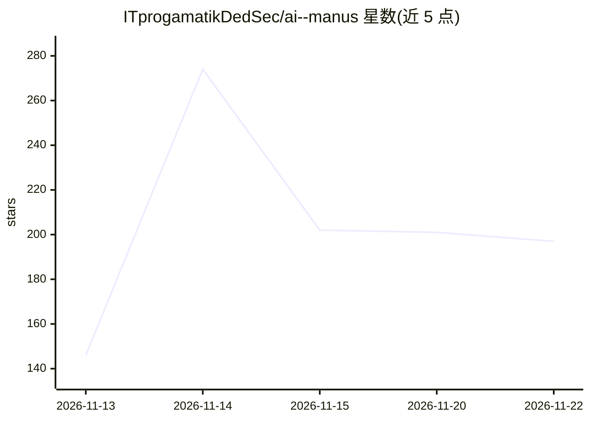

# ITprogamatikDedSec/ai--manus

⭐ 197 · Apache-2.0 · 推送 2026-11-21 · [GitHub](https://github.com/ITprogamatikDedSec/ai--manus) · 个人维护

**面向个人用户的自主 AI Agent，代用户执行代码与浏览器操作**

README 描述 Manus 为一个自主 AI Agent：可自行运行代码、控制浏览器（导航网页、填写表单、收集信息）、执行多步骤任务，定位为家庭、学习与轻量办公场景的个人助手。提供兼容性要求表（64 位系统、4GB 内存起）与六步使用流程说明。README 未给出安装命令、代码仓库结构或下载链接，仅含宣传性功能介绍与相关搜索词列表。

## 筛选速览

| 维度 | 判定 | 备注 |
|---|---|---|
| AI 角色 | `ai-native` | 本体是模型或模型工具 |
| 许可风险 | `permissive` | Apache-2.0 |
| 部署形态 | `None` |  |
| 模型依赖 | — | README 未给出锁定关系 |
| 硬件要求 | — | 无带数字的原话,不猜 |
| 安装摩擦 | `low` | 无编译、无系统依赖或容器化 |
| 成熟度 | — | 结构信号不足 |

## 能力要点

- 自主代码执行：代理自行运行脚本完成任务
- 浏览器控制：导航网页、填写表单、收集信息
- 多步骤任务与跨会话的流程记忆（README 自述）
- 面向家庭/学习/轻量办公的定位

## 适用场景

- 让代理代为收集多个网页的资料
- 自动化整理研究笔记与运行小脚本
- 把重复的表单填写、页面检查交给代理处理

## 场景标签

`AI 助手` `浏览器自动化` · 领域:效率与自动化

## 证据(README 行号)

> L18: Manus is an autonomous AI agent designed to run code and control a browser on your behalf. Instead of acting like a
> L35: ## Compatibility
> L41: |**Memory (RAM)**|4 GB|8 GB or more for heavy Manus autonomous tasks|

## 星数曲线

2026-11-13 146 → 2026-11-22 197（+51）

---
*卡片 v1 · prompt 1.4 · 生成 2026-11-19 · 置信度 mid · 依据 README sha `b5a0718b8e49` · [字段定义](../../DATASET.md)*
