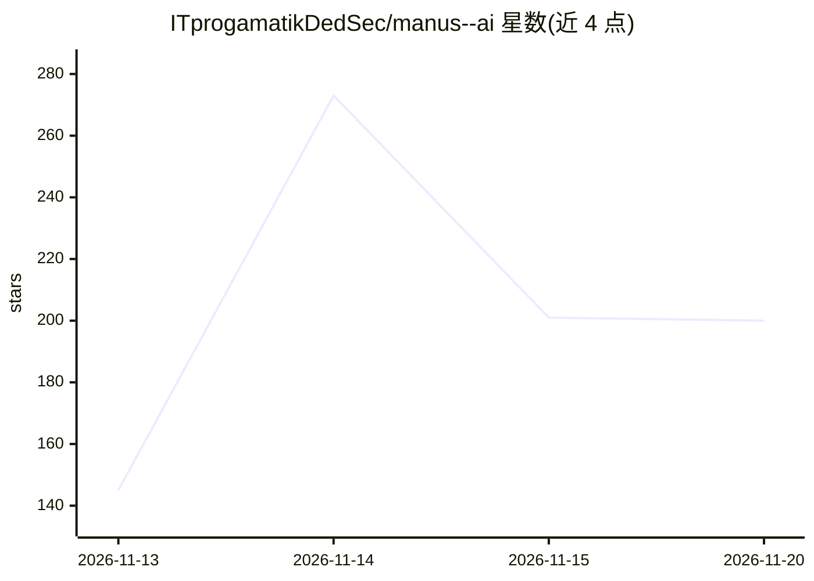

# ITprogamatikDedSec/manus--ai

⭐ 200 · Apache-2.0 · 推送 2026-11-19 · [GitHub](https://github.com/ITprogamatikDedSec/manus--ai) · 个人维护

**自主执行代码与浏览器操作的通用 AI Agent 助手**

定位为通用自主 AI Agent：在用户授权下自动编写并执行脚本、控制浏览器导航网页/填写表单/采集信息、执行多步骤任务，并提供后台常驻的个人助理模式与跨会话的任务模式记忆。README 面向学生、远程办公者等非开发者用户，强调面向家庭、学习与轻量办公的小规模任务，提供下载入口与最低配置（64 位系统、双核 CPU、4GB 内存）。README 未给出安装命令、依赖清单或与具体模型服务的接入说明。

## 筛选速览

| 维度 | 判定 | 备注 |
|---|---|---|
| AI 角色 | `ai-native` | 本体是模型或模型工具 |
| 许可风险 | `permissive` | Apache-2.0 |
| 部署形态 | `None` |  |
| 模型依赖 | — | README 未给出锁定关系 |
| 硬件要求 | — | 无带数字的原话,不猜 |
| 安装摩擦 | `low` | 无编译、无系统依赖或容器化 |
| 成熟度 | — | 结构信号不足 |

## 能力要点

- 自主执行代码完成任务的 Agent
- 浏览器控制：导航网页、填写表单、采集信息
- 后台常驻个人助理与跨会话任务模式记忆
- 提供下载入口与最低硬件/系统要求表

## 适用场景

- 让我描述需求，由代理自动收集多个网页的信息
- 把重复的文件整理、页面检查类琐事交给代理处理
- 学习和研究中自动整理笔记、运行小脚本

## 场景标签

`AI 助手` `浏览器自动化` · 领域:效率与自动化

## 证据(README 行号)

> L10: - **Autonomous Code Execution:** Manus AI agent runs code on its own to complete tasks, so you can focus on decisio
> L18: Manus is an autonomous AI agent designed to run code and control a browser on your behalf. Instead of acting like a
> L41: |**Memory (RAM)**|4 GB|8 GB or more for heavy Manus autonomous tasks|

## 星数曲线

2026-11-13 145 → 2026-11-20 200（+55）

---
*卡片 v1 · prompt 1.4 · 生成 2026-11-19 · 置信度 low · 依据 README sha `2ff41025d9ff` · [字段定义](../../DATASET.md)*
