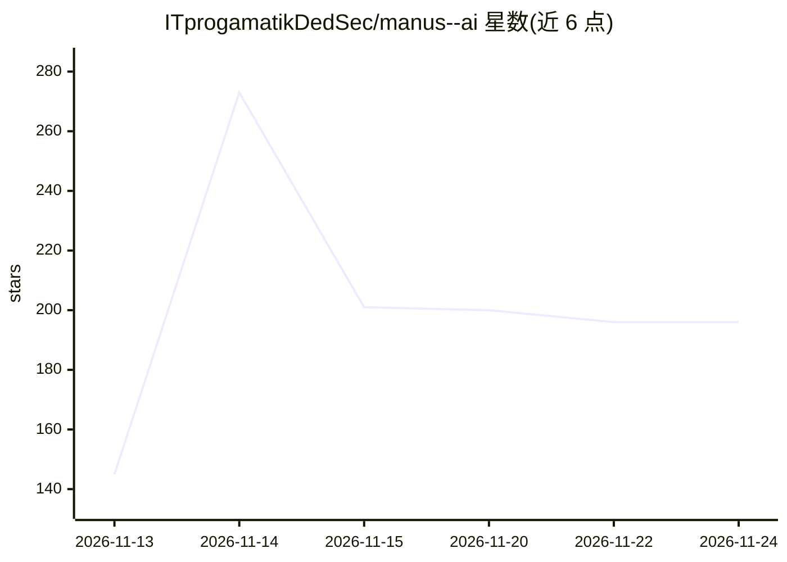

# ITprogamatikDedSec/manus--ai

⭐ — · [GitHub]() · 个人维护

**面向个人用户的自主 AI Agent，代用户执行代码与浏览器操作**

README 介绍 Manus 为一个通用自主 AI Agent：代表用户运行代码脚本并控制浏览器，执行填表、网页信息收集、多步骤任务等自动化操作，定位为面向家庭、学习与轻量办公的个人助手。内容描述了会话间保持一致性、后台待命、任务触发配置等机制；使用方式以'下载 Manus'引导为主，README 未给出源码构建、依赖清单或具体安装命令，也未说明所接入的模型服务。

## 筛选速览

| 维度 | 判定 | 备注 |
|---|---|---|
| AI 角色 | `ai-native` | 本体是模型或模型工具 |
| 许可风险 | `permissive` | — |
| 部署形态 | `None` |  |
| 模型依赖 | — | README 未给出锁定关系 |
| 硬件要求 | — | 无带数字的原话,不猜 |
| 安装摩擦 | `low` | 无编译、无系统依赖或容器化 |
| 成熟度 | — | 结构信号不足 |

## 能力要点

- 自主执行代码脚本完成任务
- 控制浏览器进行导航、填表与信息收集
- 多步骤自主任务与任务触发配置
- 面向非开发者用户，无需编程栈

## 适用场景

- 收集研究资料并整理笔记
- 自动填写重复性网页表单
- 从多个网页页面收集数据做小报告
- 日常重复性小任务的委派执行

## 场景标签

`AI 助手` `浏览器自动化` · 领域:效率与自动化

## 证据(README 行号)

> L10: - **Autonomous Code Execution:** Manus AI agent runs code on its own to complete tasks, so you can focus on decisio
> L18: Manus is an autonomous AI agent designed to run code and control a browser on your behalf. Instead of acting like a

## 星数曲线

2026-11-13 145 → 2026-11-24 196（+51）

---
*卡片 v1 · prompt 1.4 · 生成 2026-11-20 · 置信度 low · 依据 README sha `32a1637f74d2` · [字段定义](../../DATASET.md)*
