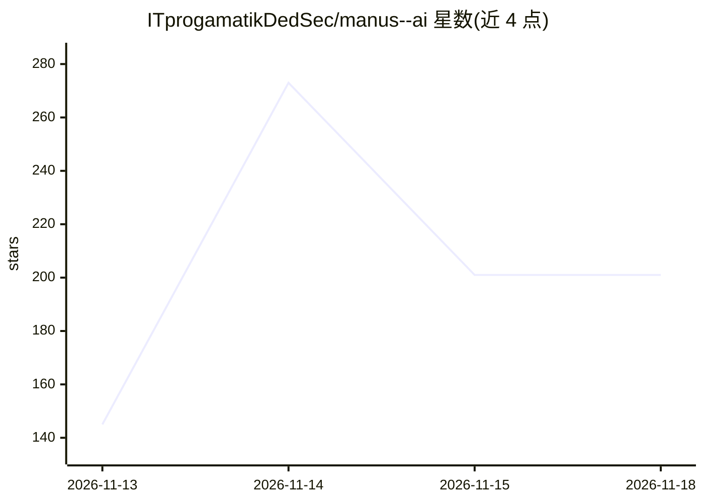

# ITprogamatikDedSec/manus--ai

⭐ 201 · Apache-2.0 · 推送 2026-11-17 · [GitHub](https://github.com/ITprogamatikDedSec/manus--ai) · 个人维护

**面向个人用户的自主 AI 代理：代为写代码、控制浏览器、执行多步任务**

Manus 是一个自主 AI agent 应用，用户描述需求后由 agent 规划并执行：自行编写和运行脚本、打开网页并与之交互、执行多步任务，可在后台作为个人助手响应。README 将其定位为面向家庭、学习与轻量工作的小型工具，而非企业平台。README 以功能介绍和使用步骤为主，未给出具体的安装命令、模型接入方式或代码运行说明，仅提供一份最低/推荐硬件配置表（4GB/8GB 内存）。

## 筛选速览

| 维度 | 判定 | 备注 |
|---|---|---|
| AI 角色 | `ai-native` | 本体是模型或模型工具 |
| 许可风险 | `permissive` | Apache-2.0 |
| 部署形态 | `None` |  |
| 模型依赖 | — | README 未给出锁定关系 |
| 硬件要求 | — | 无带数字的原话,不猜 |
| 安装摩擦 | `low` | 无编译、无系统依赖或容器化 |
| 成熟度 | — | 结构信号不足 |

## 能力要点

- 自主执行代码与脚本运行
- 浏览器控制：导航、填表、抓取信息
- 代码与浏览器动作可在同一任务流中衔接
- 跨会话保持任务模式，减少重复说明

## 适用场景

- 让 agent 代为完成重复性的网页操作与小脚本任务
- 学习与研究中收集资料、整理笔记
- 轻量办公场景下汇总多页面信息

## 场景标签

`AI 助手` `浏览器自动化` `编码 Agent` · 领域:效率与自动化

## 证据(README 行号)

> L10: - **Autonomous Code Execution:** Manus AI agent runs code on its own to complete tasks, so you can focus on decisio
> L18: Manus is an autonomous AI agent designed to run code and control a browser on your behalf. Instead of acting like a

## 星数曲线

2026-11-13 145 → 2026-11-18 201（+56）

---
*卡片 v1 · prompt 1.4 · 生成 2026-11-17 · 置信度 mid · 依据 README sha `0f78ee3a5dd2` · [字段定义](../../DATASET.md)*
