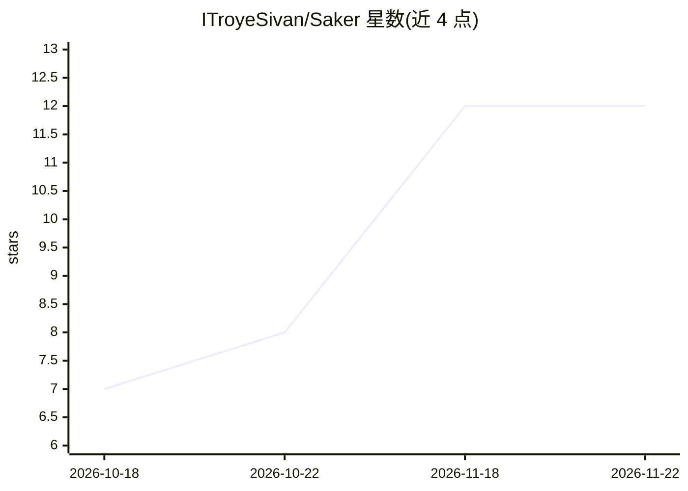

# ITroyeSivan/Saker

⭐ 12 · JavaScript · MIT · 推送 2026-11-05 · [GitHub](https://github.com/ITroyeSivan/Saker) · [官网](https://github.com/ITroyeSivan/Saker/releases/latest) · 个人维护 · 中文 README

**基于 DeepSeek Harness Desktop 的 AI 安全测试插件，面向授权渗透场景**

Saker 是 DeepSeek Harness Desktop 的安全测试插件，面向 SRC 挖掘、授权攻防、项目案例测试和 CTF。提供自由测试、案例测试、比赛模式三种场景，将浏览器操作、测试资料、工具接入和执行记录整合在同一聊天入口；支持 Chrome for Testing + CDP 操作真实页面，可接入 Burp/Yakit 等 MCP 服务与 FOFA/Hunter/Quake 资产平台。通过安装脚本向官方 Desktop 安装 15 个插件，需 Windows 10/11 与 Node.js 24.9+，仅限授权环境使用。

## 筛选速览

| 维度 | 判定 | 备注 |
|---|---|---|
| AI 角色 | `ai-native` | 本体是模型或模型工具 |
| 许可风险 | `permissive` | MIT |
| 部署形态 | `None` |  |
| 模型依赖 | locked-api |  |
| 硬件要求 | — | 无带数字的原话,不猜 |
| 安装摩擦 | `low` | 无编译、无系统依赖或容器化 |
| 成熟度 | `idea` | |

## 能力要点

- 三种测试场景：自由测试、案例测试、比赛模式
- Chrome for Testing + CDP 操作真实页面，支持人工随时接手
- 可接入 Burp、Yakit 等 MCP 服务与 FOFA/Hunter/Quake 资产平台
- 程序自动保存工具调用与执行记录，支持结果导出

## 适用场景

- 对授权域名和资产清单做信息收集与入口验证
- 导入项目环境和 Excel 案例逐项执行测试并导出依据
- CTF 比赛中管理题面、附件、本地执行与候选答案
- 结合 CVE 公告和 PoC 仓库核对资产利用条件

## 场景标签

`网络安全` · 领域:学习与行业

## 证据(README 行号)

> L17: Saker 是 DeepSeek Harness Desktop 的安全测试插件，面向 **SRC 挖掘、授权攻防、项目案例测试和 CTF**。
> L31: Saker 以 dsh 的会话、模型和工具机制为基础，围绕安全测试补充资料管理、浏览器操作、案例执行、比赛环境和结果查看。我们的设计取舍也落实在这些功能中。

## 星数曲线

2026-10-18 7 → 2026-11-22 12（+5）

---
*卡片 v1 · prompt 1.4 · 生成 2026-11-18 · 置信度 high · 依据 README sha `2f190d3c5eec` · [字段定义](../../DATASET.md)*
