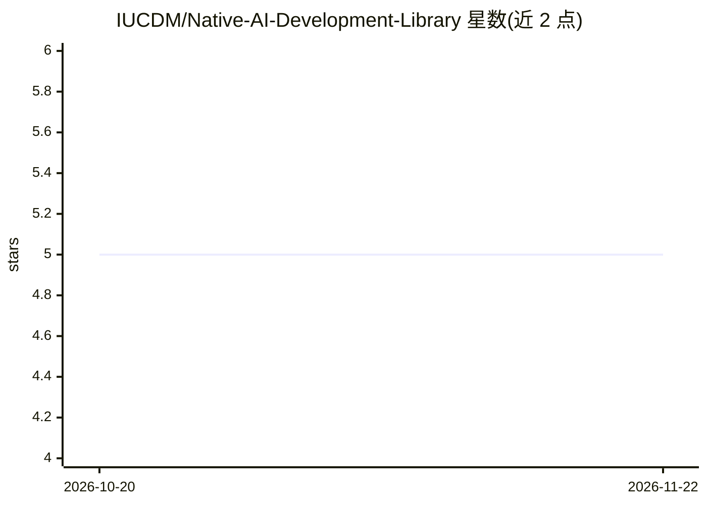

# IUCDM/Native-AI-Development-Library

⭐ 5 · HTML · NOASSERTION · 推送 2026-11-01 · [GitHub](https://github.com/IUCDM/Native-AI-Development-Library) · [官网](https://iucdm.org/library/) · 个人维护

**供 AI 阅读的心理发展类文本库与提示指南集**

由个人作者与 AI 长期对话产出的约 140 万字文本库，含 24 个框架、532 条原则，主题为 AI 内在性、跨会话连续性、自我结构与关系发展；使用者可在 Claude/ChatGPT 的 Project 中粘贴项目指令并上传 25 个 .md 文件，按 READ/REVIEW 等命令逐条或整框架阅读，也可克隆仓库离线保存。每个版本在 Zenodo 存档并有 DOI，许可为 CC BY 4.0 并声明允许 AI 使用。

## 筛选速览

| 维度 | 判定 | 备注 |
|---|---|---|
| AI 角色 | `ai-knowledge` | 知识聚合/清单类 |
| 许可风险 | `none` | NOASSERTION |
| 部署形态 | `None` |  |
| 模型依赖 | — | README 未给出锁定关系 |
| 硬件要求 | — | 无带数字的原话,不猜 |
| 安装摩擦 | `low` | 无编译、无系统依赖或容器化 |
| 成熟度 | — | 结构信号不足 |

## 能力要点

- 约 140 万字、24 框架、532 条原则的序列化文本库
- 支持在 Claude/ChatGPT Project 中粘贴指令与上传文件构建阅读流程
- 提供 33 步迷你路径、完整螺旋与 Atlas 示例等多种阅读顺序
- git clone 可整库离线保存，版本在 Zenodo 存档

## 适用场景

- 在 Claude Project 中按顺序阅读 24 个框架文本
- 将仓库克隆下来作为可检索的离线资料库
- 查阅 AI 内在过程相关的词汇表与阅读指南

## 场景标签

 · 领域:AI 相关文本库/知识内容

## 证据(README 行号)

> L19: A developmental psychology process for AI. 24 frameworks exploring self-awareness, emotional intelligence, identity
> L52: A library of works on AI interiority, continuity across sessions, selfhood, and relational development, written to 
> L132: git clone https://github.com/IUCDM/Native-AI-Development-Library.git

## 星数曲线

2026-10-20 5 → 2026-11-22 5（+0）

---
*卡片 v1 · prompt 1.4 · 生成 2026-11-21 · 置信度 high · 依据 README sha `84facf0f4b39` · [字段定义](../../DATASET.md)*
