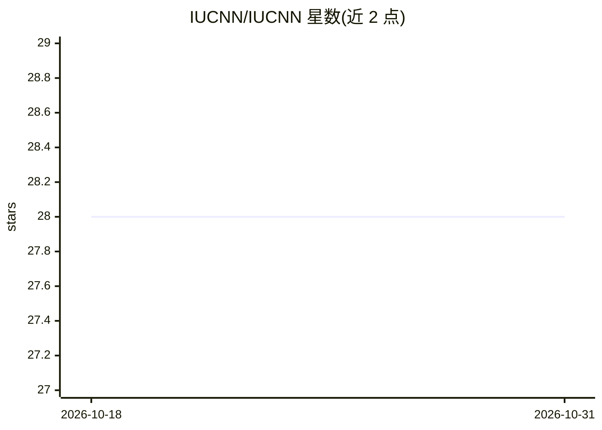

# IUCNN/IUCNN

⭐ 28 · R · 推送 2026-07-08 · [GitHub](https://github.com/IUCNN/IUCNN) · 组织维护

**R 包：用神经网络预测物种 IUCN 红色名录受威胁等级**

R 包，基于地理物种分布记录、环境数据与已有 IUCN 红色名录评估训练神经网络，批量预测未评估物种的灭绝风险等级。核心计算在 Python 端进行：通过 reticulate 建立 Miniconda 环境，依赖 TensorFlow/Keras 与作者团队的 npBNN 库。提供系统发育特征与地理采样偏差特征（iucnn_phylogenetic_features / iucnn_bias_features），支持卷积神经网络特征（iucnn_cnn_features）。安装需约 3 GB 磁盘空间，示例数据下载约 500 MB；版本 4.0 与 2.x 分析管线可能不兼容。

## 筛选速览

| 维度 | 判定 | 备注 |
|---|---|---|
| AI 角色 | `ai-native` | 本体是模型或模型工具 |
| 许可风险 | `none` | — |
| 部署形态 | `None` |  |
| 模型依赖 | — | README 未给出锁定关系 |
| 硬件要求 | — | 无带数字的原话,不猜 |
| 安装摩擦 | `low` | 无编译、无系统依赖或容器化 |
| 成熟度 | — | 结构信号不足 |

## 能力要点

- 基于物种分布与环境数据训练神经网络预测 IUCN 等级
- 支持 CNN 特征、系统发育特征与地理采样偏差特征
- R 接口 + Python（TensorFlow/Keras/npBNN）后端
- 提供详细教程 vignette 与引用文献

## 适用场景

- 我想为某个类群批量估计未评估物种的受威胁等级
- 我想用分布与环境数据做近似保护评估以辅助优先级排序
- 我想结合系统发育与采样偏差信息改进预测

## 场景标签

`科研工具` · 领域:学习与行业

## 证据(README 行号)

> L8: Batch estimation of species' IUCN Red List threat status using neural networks.
> L79: Zizka A, Andermann T, Silvestro D (2022). "IUCNN - Deep learning approaches to approximate species’ extinction risk

## 星数曲线

2026-10-18 28 → 2026-10-31 28（+0）

---
*卡片 v1 · prompt 1.4 · 生成 2026-10-26 · 置信度 high · 依据 README sha `ba98715a3d03` · [字段定义](../../DATASET.md)*
