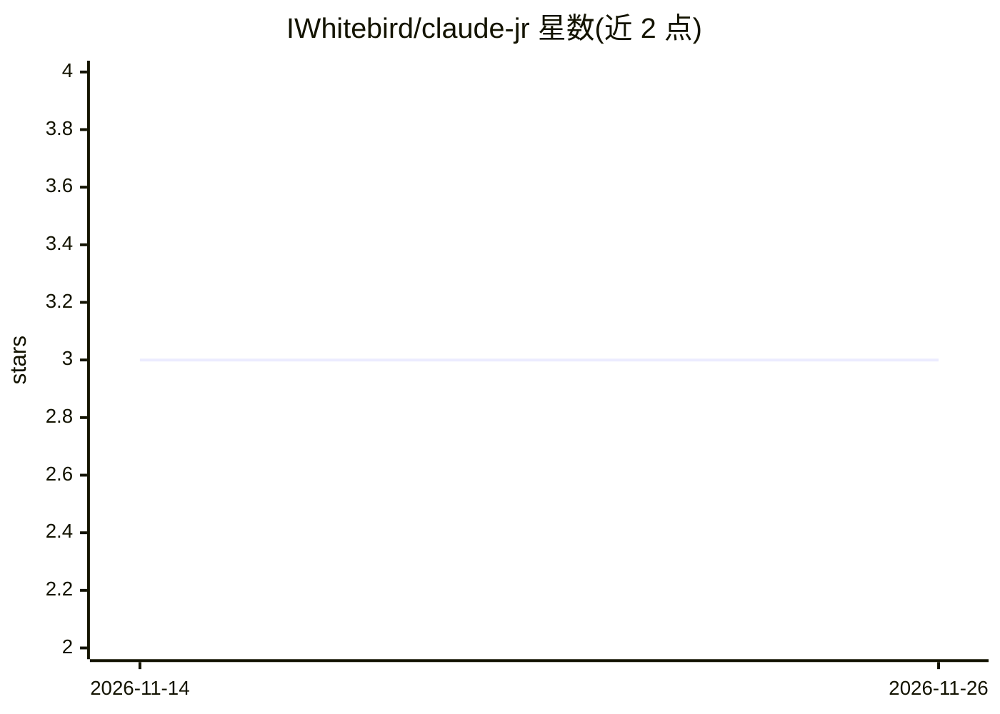

# IWhitebird/claude-jr

⭐ 3 · Rust · MIT · 推送 2026-11-25 · [GitHub](https://github.com/IWhitebird/claude-jr) · [官网](https://claudejr.iwhitebird.com) · 个人维护

**终端里的轻量编码 agent：Rust 单二进制替代 Claude Code**

以单个 2 MB Rust 二进制发行的终端编码 agent，占用 0.7 MB 内存、4 ms 启动，自称在 SWE-bench Verified 达 93.4%。默认使用 Claude，可通过 `-m provider/model` 切换 OpenAI、Gemini、Groq、OpenRouter 或本地 Ollama。提供五种权限模式、沙箱、`/rewind` 回退、后台任务（独立 git 分支）、subagents、skills、MCP 服务器与会话恢复。支持 Linux/macOS（x86-64/ARM），Windows 经 WSL 运行，MIT 许可，含 414 项测试与 97% 行覆盖率。

## 筛选速览

| 维度 | 判定 | 备注 |
|---|---|---|
| AI 角色 | `ai-native` | 本体是模型或模型工具 |
| 许可风险 | `permissive` | MIT |
| 部署形态 | `None` |  |
| 模型依赖 | local-ok | 支持本地模型 |
| 硬件要求 | — | 无带数字的原话,不猜 |
| 安装摩擦 | `low` | 无编译、无系统依赖或容器化 |
| 成熟度 | — | 结构信号不足 |

## 能力要点

- 单文件 2 MB 二进制，0.7 MB 空闲内存、4 ms 启动
- 多模型后端：Claude 默认，可切换 OpenAI/Gemini/Groq/OpenRouter/本地 Ollama
- 五种权限模式、沙箱与 /rewind 回退机制
- 后台任务运行在独立 git 分支，支持经 MCP 接收 Claude Code/Cursor/Codex 派发的工作

## 适用场景

- 在终端里让 agent 修复失败的测试或偶发缺陷
- 用 `-p ... -y` 模式在脚本和 CI 中执行单任务编码
- 本地 Ollama 模型下运行终端编码 agent
- 在同一台机器并行运行多个后台编码任务

## 场景标签

`编码 Agent` · 领域:编码与开发

## 证据(README 行号)

> L6:  A full coding agent for the terminal, in one 2 MB binary.
> L33: - **Any model.** Claude by default; OpenAI, Gemini, Groq, OpenRouter or a local Ollama with `-m provider/model`.
> L34: - **It asks first.** Five permission modes, a sandbox, and `/rewind` to take back anything it did.

## 星数曲线

2026-11-14 3 → 2026-11-26 3（+0）

---
*卡片 v1 · prompt 1.4 · 生成 2026-11-22 · 置信度 high · 依据 README sha `0e7f54aa98a2` · [字段定义](../../DATASET.md)*
