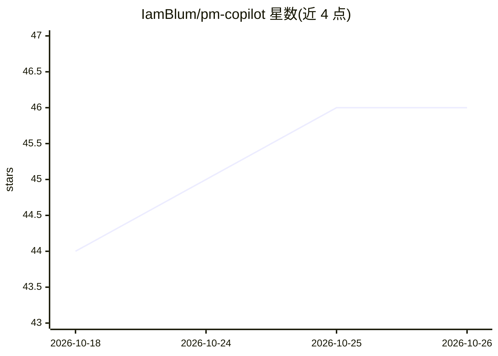

# IamBlum/pm-copilot

⭐ 46 · Shell · MIT · 推送 2026-09-20 · [GitHub](https://github.com/IamBlum/pm-copilot) · [官网](https://imdanielblum.com) · 个人维护

**面向产品经理的 Claude 插件：代跑周会准备、晨报等例行动作**

运行在 Claude Cowork 与 Claude Code 中的插件：安装时在工作区写入 CLAUDE.md 路由脑与 memory/ 文件夹，存储用户角色、协作对象、优先级等上下文。提供 9 个技能覆盖四个日常工作流（每周准备、晨间简报、未闭环事项、自我改进）及记忆维护、外部建议评估等功能。通过 Claude 连接器或 MCP 服务器接入用户既有工具，工具无关。记忆数据保留在本机；工作流需用户手动触发，不支持云端定时任务。

## 筛选速览

| 维度 | 判定 | 备注 |
|---|---|---|
| AI 角色 | `ai-native` | 本体是模型或模型工具 |
| 许可风险 | `permissive` | MIT |
| 部署形态 | `None` |  |
| 模型依赖 | — | README 未给出锁定关系 |
| 硬件要求 | — | 无带数字的原话,不猜 |
| 安装摩擦 | `low` | 无编译、无系统依赖或容器化 |
| 成熟度 | — | 结构信号不足 |

## 能力要点

- 四个核心工作流：weekly-prep / morning-brief / open-loops / self-improvement
- 本地 memory 文件夹持续维护用户角色、优先级、决策等上下文
- 通过 Claude 连接器或自有 MCP 服务器接入既有工具，工具无关
- improve 技能可评估外部 Claude 使用技巧是否值得采纳

## 适用场景

- 每周开始前梳理优先级、每天早晨获取事项简报
- 追踪等待他人处理或他人等待自己的未闭环事项
- 让助手逐步学习自己的工作方式并改进配置

## 场景标签

`AI 助手` `工作流自动化` `Agent 记忆` · 领域:Agent 开发

## 证据(README 行号)

> L9: It runs inside Claude Cowork, and works in Claude Code too.
> L19: - **Weekly prep** starts your week. It pulls from your tools and walks you through setting your priorities and your
> L47: - **Claude Cowork or Claude Code.**

## 星数曲线

2026-10-18 44 → 2026-10-26 46（+2）

---
*卡片 v1 · prompt 1.4 · 生成 2026-10-25 · 置信度 high · 依据 README sha `dcd593c809e2` · [字段定义](../../DATASET.md)*
