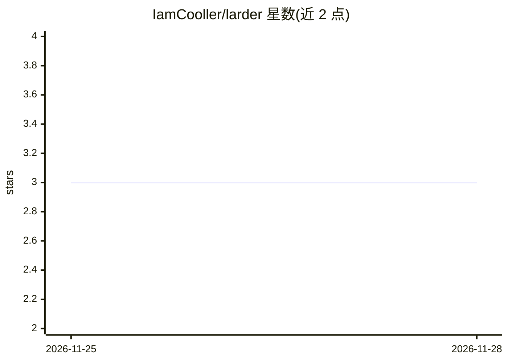

# IamCooller/larder

⭐ 3 · Python · MIT · 推送 2026-11-19 · [GitHub](https://github.com/IamCooller/larder) · 个人维护

**让普通电脑本地运行大 MoE 模型的推理引擎与启动器**

本地大模型推理引擎：按 token 需要从 SSD 流式读取 MoE 专家权重，使超出内存的大模型可以在普通电脑上运行。一条命令测量机器、选择匹配模型、完成安装，并启动浏览器聊天页与 OpenAI 兼容 API（127.0.0.1:8800/v1）。支持流式输出、tools、图像输入、thinking 开关。安装脚本需 g++ 编译原生读取器；支持 Apple Silicon（Metal）与带 NVIDIA GPU 的 Linux（CUDA），README 自述为实验性项目，仅一名作者、在两台机器上测试。

## 筛选速览

| 维度 | 判定 | 备注 |
|---|---|---|
| AI 角色 | `ai-ecosystem` | LLM/agent 周边工具 |
| 许可风险 | `permissive` | MIT |
| 部署形态 | `library` | 以包/库形式分发 |
| 模型依赖 | — | README 未给出锁定关系 |
| 硬件要求 | — | 无带数字的原话,不猜 |
| 安装摩擦 | `high` | 编译与系统依赖俱全 |
| 成熟度 | `idea` | |

## 能力要点

- 专家权重从 SSD 按需流式读取，模型可超出内存运行
- 一条命令测机、选型、下载并启动，终端菜单可预估本机速度
- 提供 OpenAI 兼容 API 与本地浏览器聊天页，页面资源全部本地服务
- API 支持流式、tools、图像输入与 usage 计数

## 适用场景

- 在 16 GB 内存的 Mac 或 PC 上本地跑 35B 级 MoE 模型
- 给 Continue/Cline 等编辑器提供本地自定义推理端点
- 离线环境下通过浏览器聊天页与本地模型对话

## 场景标签

`推理引擎` · 领域:训练与推理

## 证据(README 行号)

> L5: This is an inference engine that runs large language models on a computer you already own, with the model's expert w
> L84: - **An OpenAI-compatible API.** `http://127.0.0.1:8800/v1` when the server is started through `./larder`: the launc
> L108: |Computers|Apple Silicon Mac with macOS (Metal); Linux x86_64 with an NVIDIA GPU (CUDA)|

## 星数曲线

2026-11-25 3 → 2026-11-28 3（+0）

---
*卡片 v1 · prompt 1.4 · 生成 2026-11-24 · 置信度 high · 依据 README sha `6619bf5be2fc` · [字段定义](../../DATASET.md)*
