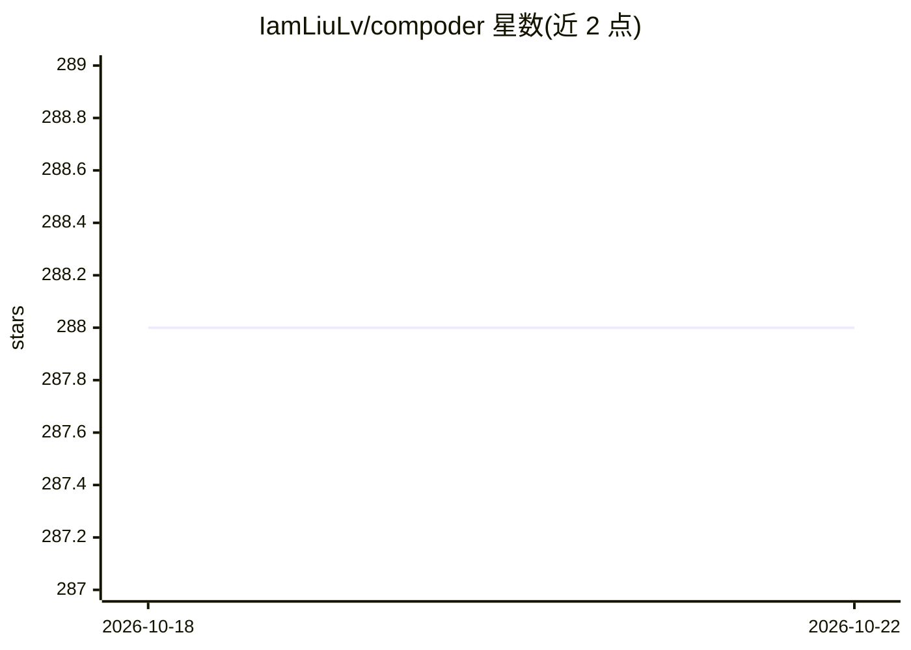

# IamLiuLv/compoder

⭐ 288 · TypeScript · NOASSERTION · 推送 2025-11-09 · [GitHub](https://github.com/IamLiuLv/compoder) · 个人维护 · 中文 README

**面向前端工程师的 AI 组件代码生成引擎**

开源的 AI 组件代码生成引擎：基于特定技术栈（React、Vue 等）、组件库（Mui、Antd、Element-Plus、Shadcn UI 等）、场景（落地页、邮件模板、后台表单等）与 AI 模型（OpenAI、Claude）自定义 Codegen。功能含文本/图片转代码、代码版本迭代、在线代码微调与实时预览沙箱。本地运行需 Node.js v18+、pnpm v9+、Docker 与 Docker Compose；技术栈基于 Next.js、MongoDB、Vercel AI SDK 等。路线图含 Code/Figma 双向转换与模板市场。

## 筛选速览

| 维度 | 判定 | 备注 |
|---|---|---|
| AI 角色 | `ai-native` | 本体是模型或模型工具 |
| 许可风险 | `none` | NOASSERTION |
| 部署形态 | `self-host` | docker 或自建部署 |
| 模型依赖 | — | README 未给出锁定关系 |
| 硬件要求 | — | 无带数字的原话,不猜 |
| 安装摩擦 | `low` | 无编译、无系统依赖或容器化 |
| 成熟度 | — | 结构信号不足 |

## 能力要点

- 按技术栈/组件库/场景/代码规范/AI 模型自定义组件代码生成器
- 文本与图片输入生成组件代码，支持版本迭代与在线微调
- 内置实时预览沙箱，支持 React、Vue 及私有包秒级渲染
- 基于 Next.js、Vercel AI SDK、MongoDB 等技术栈构建

## 适用场景

- 我需要为团队的私有组件库定制 AI 代码生成器
- 用文字或设计图快速生成落地页、邮件模板等场景组件
- 生成后在线微调代码并实时预览效果

## 场景标签

`代码生成` · 领域:编码与开发

## 证据(README 行号)

> L5:  AI-Powered Component Code Generator For Every Frontend Engineer
> L51: - Prompt (Text, Image) To Code: Input text or images to generate component code

## 星数曲线

2026-10-18 288 → 2026-10-22 288（+0）

---
*卡片 v1 · prompt 1.4 · 生成 2026-10-22 · 置信度 mid · 依据 README sha `8f4da7f3be2e` · [字段定义](../../DATASET.md)*
