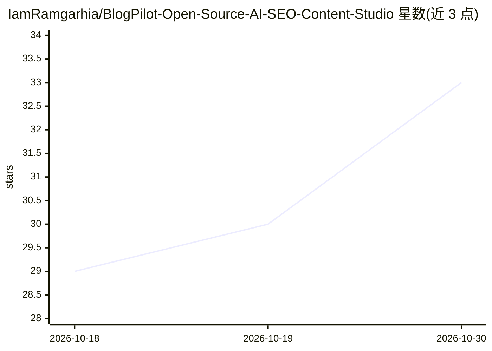

# IamRamgarhia/BlogPilot-Open-Source-AI-SEO-Content-Studio

⭐ 33 · TypeScript · MIT · 推送 2026-08-15 · [GitHub](https://github.com/IamRamgarhia/BlogPilot-Open-Source-AI-SEO-Content-Studio) · [官网](https://dicecodes.com/) · 组织维护

**自托管的 AI SEO 内容工作室：写作、审计、评分一站式**

基于 Next.js 的开源自托管 Web 应用，覆盖 SEO 内容生产全流程：一个 URL 自动发现站点信息、免费 API 关键词研究、方法论驱动的 AI 写作（先加载 SEO 剧本再调用 AI）、本地 TF-IDF 实时内容评分编辑器、28 条规则的技术 SEO 爬虫审计、社交改写与 7 种 CMS 导出、排名追踪与内容衰减监控。支持 12+ AI 提供商（含 Ollama/LM Studio 本地）自动故障转移，数据存于单个 SQLite 文件。面向独立博主、利基站主、SEO 代理与营销团队，可跑在笔记本、Vercel 免费层或 Docker。

## 筛选速览

| 维度 | 判定 | 备注 |
|---|---|---|
| AI 角色 | `ai-native` | 本体是模型或模型工具 |
| 许可风险 | `permissive` | MIT |
| 部署形态 | `library` | 以包/库形式分发 |
| 模型依赖 | local-ok | 支持本地模型 |
| 硬件要求 | — | 无带数字的原话,不猜 |
| 安装摩擦 | `low` | 无编译、无系统依赖或容器化 |
| 成熟度 | — | 结构信号不足 |

## 能力要点

- 39 个模块、7 个中心（Discover/Research/Plan/Write/Score/Distribute/Measure）
- 12+ AI 提供商单一接口接入，含 Ollama/LM Studio 本地离线
- 本地 TF-IDF 实时内容评分（800ms 去抖），无 AI 成本
- 45 个版本化 SEO 方法论文件，AI 生成前先加载剧本
- 28 条规则技术 SEO 爬虫审计与同类关键词蚕食检测

## 适用场景

- 我不想每月付几百美元订阅多个 SEO 工具，想要一个自托管替代
- 用免费 Gemini key 生成符合 SEO 方法论的博客文章
- 对我的网站做技术 SEO 爬虫审计并导出修复清单
- 为多个客户站点集中管理内容生产与排名追踪

## 场景标签

`AI 写作` · 领域:内容生成

## 证据(README 行号)

> L23: **BlogPilot AI is free, open-source, and self-hostable.** Bring your own AI key — free Google Gemini works (1,500 r
> L143: ### Write · methodology-driven AI

## 星数曲线

2026-10-18 29 → 2026-10-30 33（+4）

---
*卡片 v1 · prompt 1.4 · 生成 2026-10-26 · 置信度 mid · 依据 README sha `0119b18c8a31` · [字段定义](../../DATASET.md)*
