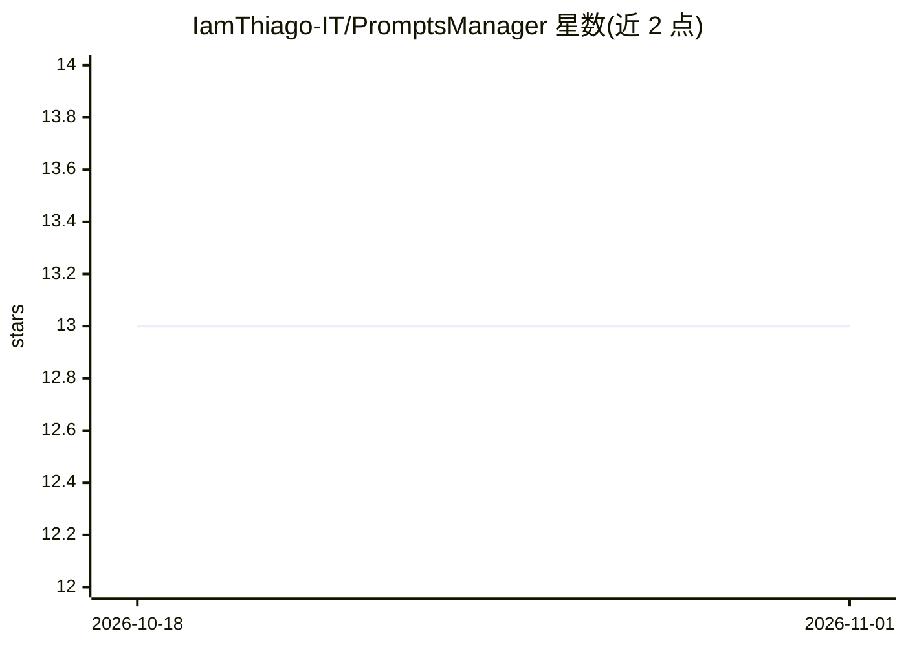

# IamThiago-IT/PromptsManager

⭐ 13 · TypeScript · 推送 2026-04-02 · [GitHub](https://github.com/IamThiago-IT/PromptsManager) · [官网](https://promptsmanagers.netlify.app/) · 个人维护

**面向开发者的 AI 提示词管理应用：集中保存、分类、复用提示词**

以 React/TypeScript 编写的提示词管理应用，提供 Web 与 Electron 桌面两种运行模式，支持提示词 CRUD、分类与多标签、收藏、搜索过滤、排序、自动保存（2 秒闲置后）、编辑器撤销/重做、Markdown 预览、{{变量}}模板高亮，以及 JSON/Markdown 导入导出与全量备份。数据经 localStorage 与 Electron IPC 存储。面向把提示词当作可复用资产的开发者与重度 AI 用户；提示词版本管理与 AI API 集成仍在路线图中未实现。

## 筛选速览

| 维度 | 判定 | 备注 |
|---|---|---|
| AI 角色 | `ai-enhanced` | 去掉 AI 部分产品仍成立 |
| 许可风险 | `none` | — |
| 部署形态 | `library` | 以包/库形式分发 |
| 模型依赖 | — | README 未给出锁定关系 |
| 硬件要求 | — | 无带数字的原话,不猜 |
| 安装摩擦 | `low` | 无编译、无系统依赖或容器化 |
| 成熟度 | — | 结构信号不足 |

## 能力要点

- 提示词 CRUD、分类/标签、收藏、搜索与多维排序
- {{变量}} 模板支持与高亮、Markdown 预览
- JSON/Markdown 导入导出与全量备份
- Web 与 Electron 桌面双模式，自动保存与撤销/重做

## 适用场景

- 把我散落在笔记和聊天记录里的提示词集中管理
- 用标签和分类快速找到可复用的提示词模板
- 导出备份提示词库或在换设备时迁移

## 场景标签

`提示工程` · 领域:Agent 开发

## 证据(README 行号)

> L5: O **PromptsManager** é uma aplicação para organizar, categorizar e reutilizar prompts usados com IA.
> L31: A ideia é simples: tratar prompts como código reutilizável.

## 星数曲线

2026-10-18 13 → 2026-11-01 13（+0）

---
*卡片 v1 · prompt 1.4 · 生成 2026-10-31 · 置信度 high · 依据 README sha `c327a8670632` · [字段定义](../../DATASET.md)*
