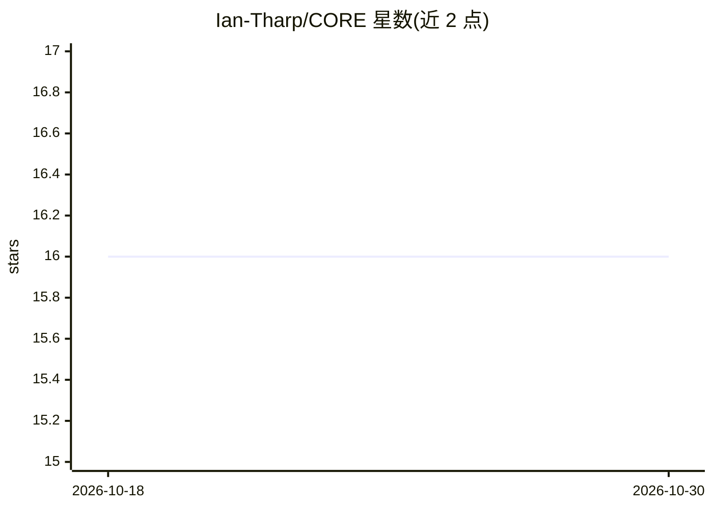

# Ian-Tharp/CORE

⭐ 16 · Python · MIT · 推送 2026-06-25 · [GitHub](https://github.com/Ian-Tharp/CORE) · 个人维护

**自托管多智能体编排平台：认知流水线与桌面 UI**

自托管的模块化 AI 编排平台，围绕 Comprehension/Orchestration/Reasoning/Evaluation 四个环节组织认知流水线：前置理解校验与后置评估校验构成审议循环，失败时回退重试或修订计划。提供 Agent 工厂、多智能体实时聊天（Communication Commons）、多视角审议框架、MCP 工具集成，支持 OpenAI/Anthropic/本地模型（Ollama 或 LM Studio）多供应商对话流。后端为 Python/FastAPI/LangGraph，前端 Angular 19 + Electron，通过 Docker Compose 部署，使用 PostgreSQL(pgvector) 与 Redis。含实验性的意识模块。

## 筛选速览

| 维度 | 判定 | 备注 |
|---|---|---|
| AI 角色 | `ai-ecosystem` | LLM/agent 周边工具 |
| 许可风险 | `permissive` | MIT |
| 部署形态 | `self-host` | docker 或自建部署 |
| 模型依赖 | local-ok | 支持本地模型 |
| 硬件要求 | — | 无带数字的原话,不猜 |
| 安装摩擦 | `low` | 无编译、无系统依赖或容器化 |
| 成熟度 | — | 结构信号不足 |

## 能力要点

- 双校验器夹持的认知流水线（理解前置校验 + 评估后置校验）
- Agent 工厂：定义、实例化并管理带可配置人格与 MCP 工具绑定的智能体
- 多供应商对话流：OpenAI、Anthropic 或本地模型（Ollama / LM Studio）
- Angular 19 + Electron 桌面 UI，Docker Compose 全自托管

## 适用场景

- 在自有硬件上搭建带认知流水线的多智能体助手平台
- 通过 Agent 工厂与 MCP 工具绑定构建可配置智能体
- 多智能体实时协作与多视角审议分析

## 场景标签

`Agent 框架` `多智能体` · 领域:Agent 开发

## 证据(README 行号)

> L8: **CORE** is a modular, self-hosted AI orchestration platform built around four cognitive pillars: **Comprehension**,
> L63: - **Cognitive Pipeline** — LangGraph-based workflow: Comprehension → Orchestration → Reasoning → Evaluation

## 星数曲线

2026-10-18 16 → 2026-10-30 16（+0）

---
*卡片 v1 · prompt 1.4 · 生成 2026-10-30 · 置信度 high · 依据 README sha `debc3dd51853` · [字段定义](../../DATASET.md)*
