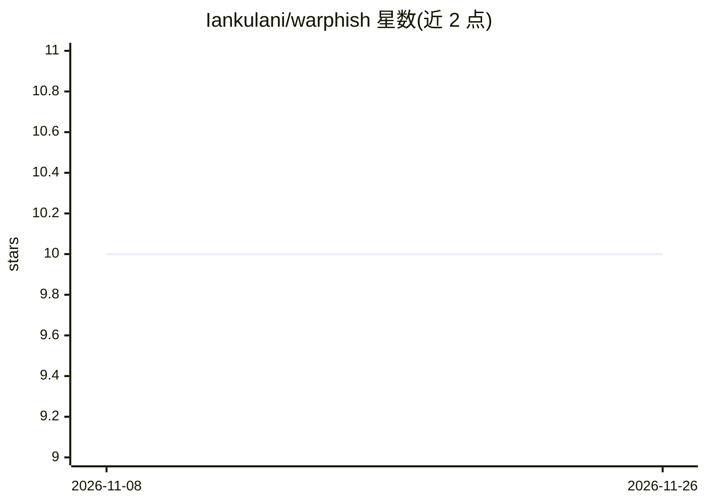

# Iankulani/warphish

⭐ 10 · Python · 推送 2026-09-30 · [GitHub](https://github.com/Iankulani/warphish) · [官网](https://iankulani.github.io/warphish-DOC/) · 个人维护

**为安全团队提供一体化渗透测试与钓鱼模拟命令平台**

由 Accurate Cyber Defense 开发的网络安全测试软件，将网络侦查、社会工程学钓鱼模拟、欺骗引擎与多平台指挥控制整合于统一命令界面。功能包括 50+ 钓鱼模板、凭证捕获、nmap/nikto 集成扫描、IP/MAC/ARP/DNS 欺骗模块，以及通过 Telegram、Discord、Slack 等 7 个渠道下发命令。使用 SQLite 存储记录，提供 RESTful API 与插件架构。README 附有授权使用的道德声明。

## 筛选速览

| 维度 | 判定 | 备注 |
|---|---|---|
| AI 角色 | `ai-enhanced` | 去掉 AI 部分产品仍成立 |
| 许可风险 | `none` | — |
| 部署形态 | `self-host` | docker 或自建部署 |
| 模型依赖 | — | README 未给出锁定关系 |
| 硬件要求 | — | 无带数字的原话,不猜 |
| 安装摩擦 | `low` | 无编译、无系统依赖或容器化 |
| 成熟度 | — | 结构信号不足 |

## 能力要点

- 50+ 预置钓鱼模板与实时凭证捕获引擎
- 集成 nmap 与 nikto 进行端口扫描与 Web 漏洞扫描
- 通过 Telegram/Discord/Slack/iMessage/Google Chat/Web 面板/Webhook 七个渠道执行命令
- 支持 IP/MAC/ARP/DNS 欺骗与 Tor SOCKS5 代理接入

## 适用场景

- 在书面授权下执行渗透测试与红队演练
- 开展员工安全意识钓鱼模拟并生成培训报告
- 验证网络 IP/MAC/DNS 等安全控制的有效性

## 场景标签

`网络安全` · 领域:学习与行业

## 证据(README 行号)

> L15: WAR PHISH is a comprehensive cybersecurity software developed by Accurate Cyber Defense, designed as an all-in-one 
> L355: # Network tools

## 星数曲线

2026-11-08 10 → 2026-11-26 10（+0）

---
*卡片 v1 · prompt 1.4 · 生成 2026-11-20 · 置信度 low · 依据 README sha `b63f497c1dae` · [字段定义](../../DATASET.md)*
