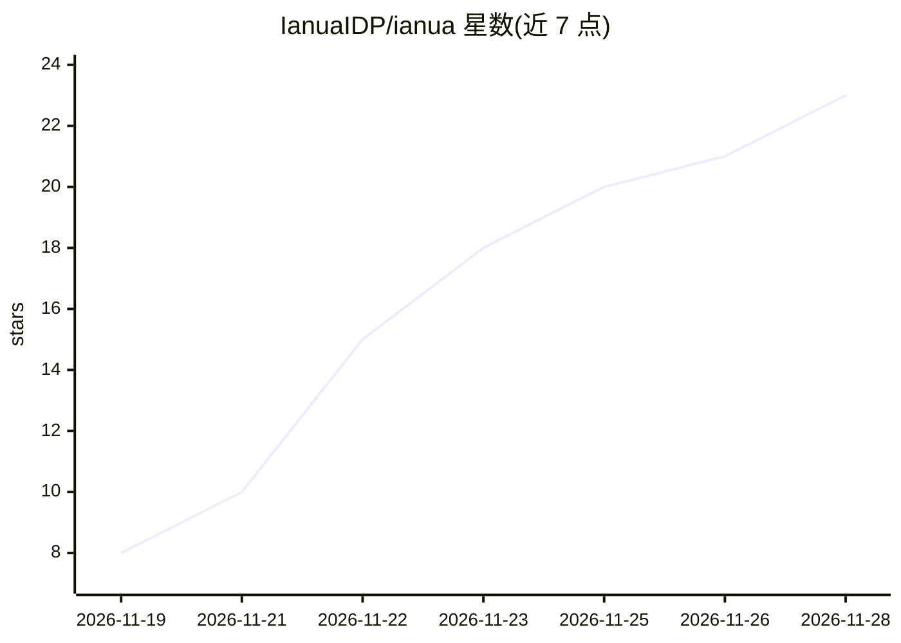

# IanuaIDP/ianua

⭐ 23 · Rust · AGPL-3.0 · 推送 2026-11-22 · [GitHub](https://github.com/IanuaIDP/ianua) · [官网](https://ianuaidp.github.io/ianua/) · 个人维护

**给团队应用与 AI agent 提供统一登录、网关与权限管控**

自托管的身份提供者与访问网关，包含登录、身份源（OAuth2/OIDC、SCIM、LDAP）、前置网关与可视化工作流四个层面。核心机制是所有调用方（人、服务、AI agent）都经同一网关：识别调用者、向平台索取策略判定、放行或默认拒绝并记录每次决策。AI agent 拥有独立密钥对与只能收窄的借来权限，可加支出上限、人工审批或中途停止。依赖 Docker 与 Node 20.9+，状态为早期（无 tag 发布）。

## 筛选速览

| 维度 | 判定 | 备注 |
|---|---|---|
| AI 角色 | `ai-enhanced` | 去掉 AI 部分产品仍成立 |
| 许可风险 | `none` | AGPL-3.0 |
| 部署形态 | `self-host` | docker 或自建部署 |
| 模型依赖 | — | README 未给出锁定关系 |
| 硬件要求 | — | 无带数字的原话,不猜 |
| 安装摩擦 | `low` | 无编译、无系统依赖或容器化 |
| 成熟度 | `idea` | |

## 能力要点

- 所有调用方（人/服务/AI agent）经同一网关，逐请求做策略判定并留审计记录
- AI agent 独立密钥对与可收窄的借来访问，支持支出上限、人工审批、任务中途停止
- 登录支持密码、passkey、TOTP、邮件/短信码、magic link 与 OIDC/SAML SSO
- 可视化工作流内置 27 个外部服务集成与沙箱代码步骤

## 适用场景

- 为自建的应用与 API 统一接入登录与权限网关
- 给 AI 助手分配独立身份并限制其可用的访问范围
- 员工离职后立即阻断其名下借出访问的 agent
- 用一套策略同时管住内部应用、 partner 调用与 agent 行为

## 场景标签

 · 领域:安全/IAM 基础设施

## 证据(README 行号)

> L49: |AI agents|Each agent has its own key pair and borrowed access that can only get narrower. Add a spending cap or a 
> L116: Ianua is source available under the Ianua Source Use License. It is not an open source license.

## 星数曲线

2026-11-19 8 → 2026-11-28 23（+15）

---
*卡片 v1 · prompt 1.4 · 生成 2026-11-20 · 置信度 high · 依据 README sha `736f67df22e0` · [字段定义](../../DATASET.md)*
