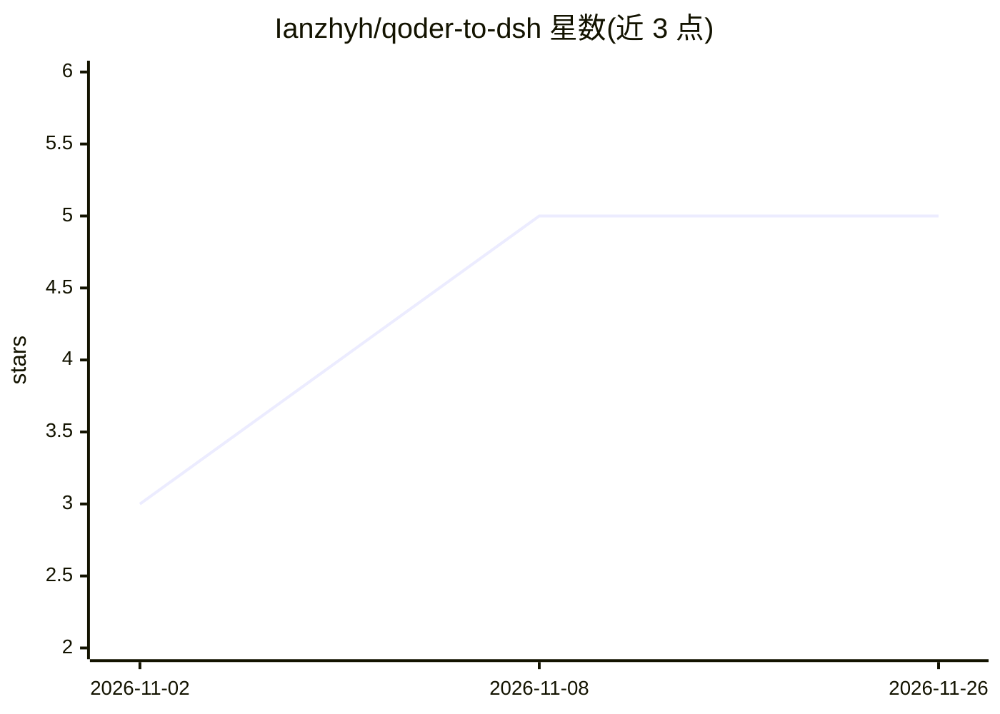

# Ianzhyh/qoder-to-dsh

⭐ 5 · JavaScript · MIT · 推送 2026-11-10 · [GitHub](https://github.com/Ianzhyh/qoder-to-dsh) · 个人维护 · 中文 README

**把 Qoder 模型额度原生接入 DSH 的插件**

为 DeepSeek Harness (DSH) 提供的插件，通过 ctx.llm.registerAdapter 将 Qoder 账号的模型额度接入 DSH 的模型选择器，无需本地桥进程或额外端口。功能覆盖凭据导入（桌面端只读扫描/浏览器授权/PAT）、流式对话与工具调用透传、动态模型目录、多账号管理、每日签到、额度与用量统计面板。数据本地保存，Windows 用 DPAPI 加密。非官方互操作实现，上游协议可能变化。

## 筛选速览

| 维度 | 判定 | 备注 |
|---|---|---|
| AI 角色 | `ai-ecosystem` | LLM/agent 周边工具 |
| 许可风险 | `permissive` | MIT |
| 部署形态 | `None` |  |
| 模型依赖 | — | README 未给出锁定关系 |
| 硬件要求 | — | 无带数字的原话,不猜 |
| 安装摩擦 | `low` | 无编译、无系统依赖或容器化 |
| 成熟度 | — | 结构信号不足 |

## 能力要点

- 通过 registerAdapter 原生注册 provider，模型直接出现在 DSH 选择器
- 支持桌面端只读导入、OAuth 设备授权与 PAT 三种登录方式
- 面板提供额度、签到、用量、请求明细、诊断等 9 个页签
- 本地优先：凭据与用量保存在本机，日志自动脱敏

## 适用场景

- 在 DSH 里直接使用 Qoder 账号的模型额度
- 管理多个 Qoder 账号并分别签到领取额度
- 统计模型调用的 tokens 与 Credits 消耗

## 场景标签

`模型网关` · 领域:Agent 开发

## 证据(README 行号)

> L3: 把 **Qoder** 的模型额度原生接进 **DeepSeek Harness (DSH)**。当前版本 **1.7.3**。
> L5: 这是一个纯 DSH 插件：没有本地桥进程，没有第二个端口，没有独立控制台。凭据读取、COSY 签名、模型目录、流式转发和设置面板都在 DSH 插件进程内完成。
> L12: - **原生 provider**：通过 `ctx.llm.registerAdapter(['qoder'], adapter)` 接入，模型直接出现在 DSH 选择器里。

## 星数曲线

2026-11-02 3 → 2026-11-26 5（+2）

---
*卡片 v1 · prompt 1.4 · 生成 2026-11-21 · 置信度 high · 依据 README sha `9f1fe1c2b9df` · [字段定义](../../DATASET.md)*
