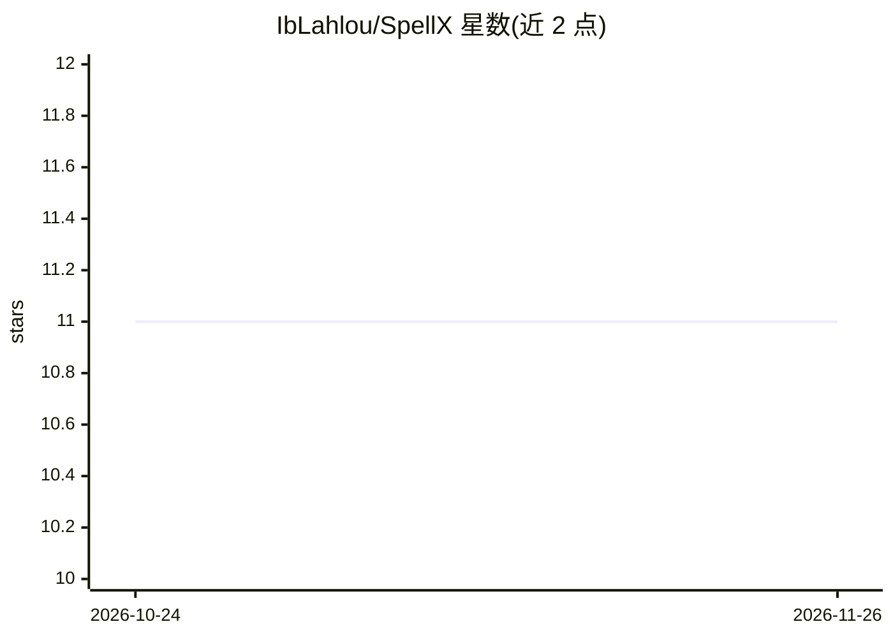

# IbLahlou/SpellX

⭐ 11 · Python · 推送 2026-10-14 · [GitHub](https://github.com/IbLahlou/SpellX) · 个人维护

**面向拼写纠正任务的端到端 MLOps 教学实践平台**

以拼写纠正这一 NLP 任务为载体的端到端 ML 系统实现：用 DVC 管理四个可复现流水线阶段（数据摄取、验证、训练、评估），Flask API 通过 HTTP 提供拼写纠正并带 HTML UI 与反馈收集，GitHub Actions 三条工作流完成 Docker 镜像构建、Cosign 签名发布到 GHCR 及 DVC 管道验证。README 自述无自动化测试、无健康检查端点、Python 3.6 基础镜像已到生命周期终点等限制。

## 筛选速览

| 维度 | 判定 | 备注 |
|---|---|---|
| AI 角色 | `ai-native` | 本体是模型或模型工具 |
| 许可风险 | `none` | — |
| 部署形态 | `self-host` | docker 或自建部署 |
| 模型依赖 | — | README 未给出锁定关系 |
| 硬件要求 | — | 无带数字的原话,不猜 |
| 安装摩擦 | `low` | 无编译、无系统依赖或容器化 |
| 成熟度 | — | 结构信号不足 |

## 能力要点

- DVC 管理的四个可复现流水线阶段与版本化数据/工件
- Flask API 提供拼写纠正 HTTP 服务并收集反馈
- GitHub Actions 自动构建、Cosign/Sigstore 签名并发布镜像至 GHCR
- YAML 配置驱动架构（config.yaml/params.yaml/dvc.yaml）

## 适用场景

- 学习 DVC 数据版本管理与 ML 流水线的完整实践
- 在容器内运行拼写纠正 HTTP 服务
- 参考镜像签名与 CI/CD 发布流程的做法

## 场景标签

`MLOps` `教程课程` · 领域:学习与行业

## 证据(README 行号)

> L3: An end-to-end ML system for spelling correction that covers the full lifecycle: data versioning with DVC, reproducib
> L9: - **Reproducible ML pipelines** — four DVC-managed stages (data ingestion, validation, training, evaluation) with ve
> L10: - **Containerized model serving** — a Flask API that loads a trained model and exposes spell-correction over HTTP.

## 星数曲线

2026-10-24 11 → 2026-11-26 11（+0）

---
*卡片 v1 · prompt 1.4 · 生成 2026-11-19 · 置信度 high · 依据 README sha `31ad14c45f22` · [字段定义](../../DATASET.md)*
