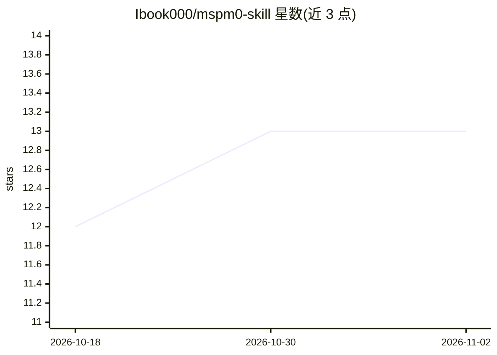

# Ibook000/mspm0-skill

⭐ 13 · HTML · MIT · 推送 2026-10-06 · [GitHub](https://github.com/Ibook000/mspm0-skill) · 个人维护 · 中文 README

**TI MSPM0 嵌入式开发的 AI Agent 规则集，让编程 Agent 安全改 SysConfig**

面向 Codex / Claude Code 等编程 Agent 的 MSPM0 嵌入式开发行为规范（非 SDK/库/IDE 插件）：以 .syscfg 为硬件配置唯一信源、禁止手工修改生成文件、修改引脚前按板级规则（BSL/晶振/SWD/板载外设）检查冲突。支持 MSPM0G3507/G3519/L1306 与立创天猛星/地猛星/地正星板卡，板卡数据存于 boards/*.json。附带 SysConfig 静态检查、CCS DSS 调试、串口控制台、例程检索等 Python 脚本；规则文档为纯 Markdown，脚本运行需 pip 安装依赖。

## 筛选速览

| 维度 | 判定 | 备注 |
|---|---|---|
| AI 角色 | `ai-ecosystem` | LLM/agent 周边工具 |
| 许可风险 | `permissive` | MIT |
| 部署形态 | `library` | 以包/库形式分发 |
| 模型依赖 | — | README 未给出锁定关系 |
| 硬件要求 | — | 无带数字的原话,不猜 |
| 安装摩擦 | `medium` | 含编译或系统依赖之一 |
| 成熟度 | — | 结构信号不足 |

## 能力要点

- 以 .syscfg 为唯一信源，改前跑 check_syscfg.py 做引脚冲突与工程结构审计
- 四块板卡的机器可读引脚/板载资源规则（boards/*.json 唯一数据源）
- 区分 CCS / Keil / CMake+GCC+OpenOCD 工程并给对应构建烧录路径
- CCS-DSS 硬件调试、Python 串口控制台、SDK 例程检索脚本

## 适用场景

- 让 Codex / Claude Code 按资深嵌入式工程师规范改 MSPM0 外设配置
- 全国大学生电子设计竞赛备赛中避免引脚冲突与篡改生成文件
- 跨天猛星/地猛星/地正星板卡移植时核对极性与可用引脚

## 场景标签

`编码 Agent` · 领域:编码与开发

## 证据(README 行号)

> L14: **mspm0-skill** 是一套面向 AI Agent（Codex / Claude Code / 兼容工具）的 TI MSPM0 嵌入式开发**规则集**。它不是 SDK、不是库、也不是 IDE 插件，而是一份让编程 Ag
> L3:  让 Codex / Claude Code 替你接管 SysConfig 外设配置与 DriverLib 驱动，你只管专注算法与控制逻辑。
> L67: 1. 先读 `SKILL.md`（权威入口：工作流、修改边界、验证口径）

## 星数曲线

2026-10-18 12 → 2026-11-02 13（+1）

---
*卡片 v1 · prompt 1.4 · 生成 2026-10-31 · 置信度 mid · 依据 README sha `c52ae7c15efa` · [字段定义](../../DATASET.md)*
