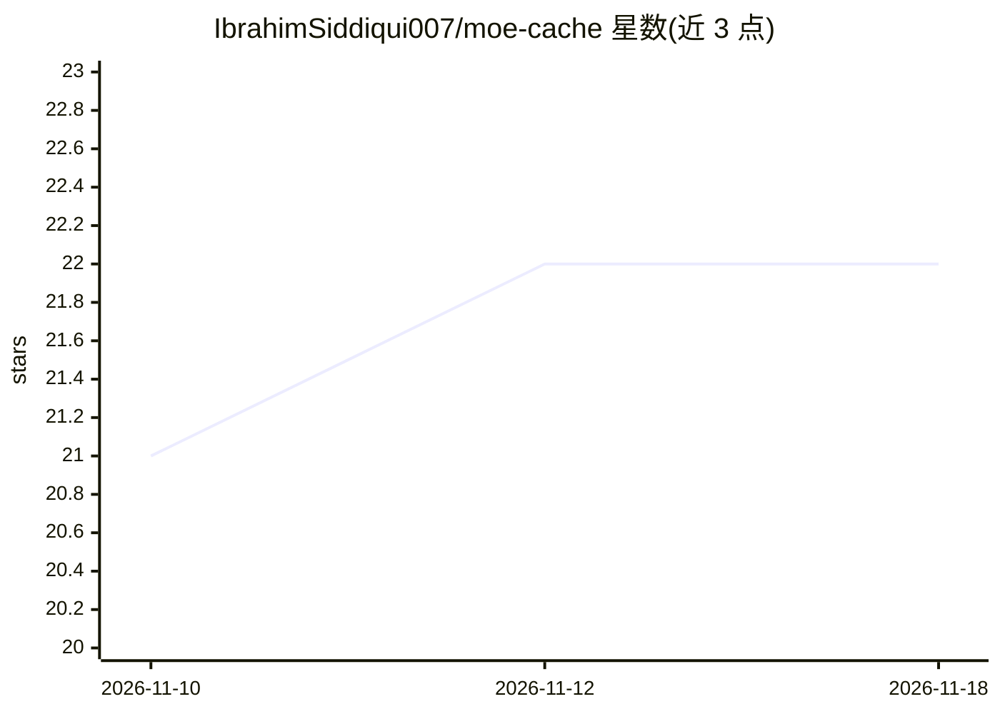

# IbrahimSiddiqui007/moe-cache

⭐ 22 · Python · MIT · 推送 2026-11-17 · [GitHub](https://github.com/IbrahimSiddiqui007/moe-cache) · 个人维护

**让普通 PC 在 RAM 不足时运行超内存的 MoE 大模型的 llama.cpp 插件**

运行在 llama-server 内部的插件：将模型实际使用的热专家保留在 RAM，其余部分从 SSD 按需读取，使 60-120 GB 的 MoE 模型（Qwen3、GLM、gpt-oss、DeepSeek）能在 32 GB RAM 的普通 PC 上运行。内置 llama.cpp b12207 加补丁集（默认关闭，行为与官方一致），也可指向未修改的官方构建；提供 --exact 恢复逐 token 一致输出。Windows 11（Vulkan）与 Linux，提供安装包与 tarball，含启动器、控制页面和编码 agent 接入。限制：模型可完整放入 RAM 或显存时作者建议直接用原生 llama.cpp。

## 筛选速览

| 维度 | 判定 | 备注 |
|---|---|---|
| AI 角色 | `ai-ecosystem` | LLM/agent 周边工具 |
| 许可风险 | `permissive` | MIT |
| 部署形态 | `desktop` | 安装包/桌面程序 |
| 模型依赖 | local-ok | 支持本地模型 |
| 硬件要求 | — | 无带数字的原话,不猜 |
| 安装摩擦 | `medium` | 含编译或系统依赖之一 |
| 成熟度 | — | 结构信号不足 |

## 能力要点

- 热专家驻留 RAM、其余从 SSD 流式读取的专家卸载机制
- 内置 llama.cpp b12207 补丁集，默认关闭时 CI 验证与官方构建行为一致
- --exact 开关关闭全部加速模式，恢复与原生 llama.cpp 相同输出
- 提供浏览器聊天页与 OpenAI 兼容 API（localhost:8080），可接入 OpenCode/Claude Code/Hermes 等编码 agent

## 适用场景

- 在 32 GB RAM 的 PC 上本地运行放不进内存的大 MoE 模型
- 搭配 OpenCode、Claude Code 等编码 agent 做长上下文本地推理
- 显存有限的 AMD/NVIDIA 卡上用 Vulkan 跑 GGUF 大模型

## 场景标签

`推理引擎` · 领域:训练与推理

## 证据(README 行号)

> L4: moe-cache is a plugin that runs inside <code>llama-server</code>; it also works on the unmodified official one. No f
> L20: MoE models (Qwen3, GLM, gpt-oss, DeepSeek) use only a few "experts" per token. When the file is bigger than your RA

## 星数曲线

2026-11-10 21 → 2026-11-18 22（+1）

---
*卡片 v1 · prompt 1.4 · 生成 2026-11-18 · 置信度 mid · 依据 README sha `5e5c77b9571e` · [字段定义](../../DATASET.md)*
