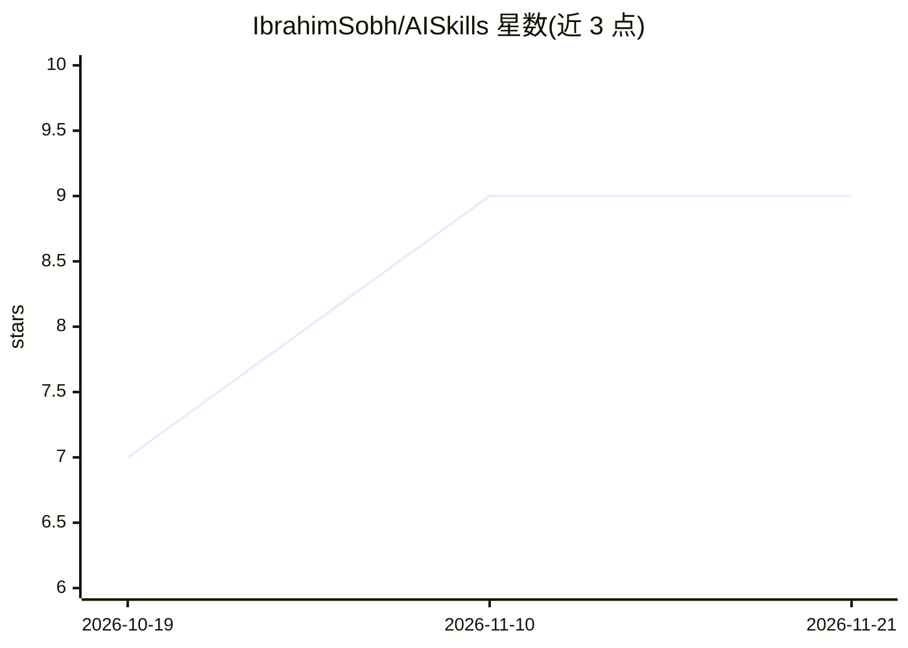

# IbrahimSobh/AISkills

⭐ 9 · HTML · MIT · 推送 2026-11-10 · [GitHub](https://github.com/IbrahimSobh/AISkills) · 个人维护

**给 AI agent 用的 SKILL.md 技能合集（10 个，含事实核查）**

一组以 SKILL.md 文件组织的 AI agent 技能合集，每个技能独立文件夹，说明何时及如何执行。收录 10 个技能：事实核查（逐条评级并附引用）、AI 新闻周报、推文撰写、高保真摘要（附校验脚本）、Mermaid 图表生成、技能体检、LinkedIn 科普帖、互动课程生成、单页幻灯片、实时检索问答。使用方式为把技能文件夹复制到 Claude Code 的技能目录，随后按名称调用。MIT 许可。

## 筛选速览

| 维度 | 判定 | 备注 |
|---|---|---|
| AI 角色 | `ai-knowledge` | 知识聚合/清单类 |
| 许可风险 | `permissive` | MIT |
| 部署形态 | `None` |  |
| 模型依赖 | — | README 未给出锁定关系 |
| 硬件要求 | — | 无带数字的原话,不猜 |
| 安装摩擦 | `low` | 无编译、无系统依赖或容器化 |
| 成熟度 | — | 结构信号不足 |

## 能力要点

- 10 个 SKILL.md 技能，含带引用的事实核查与摘要校验脚本
- 技能间可协作（skill-doitor 联动 fact-checker 与 content-diagrams）
- 复制文件夹到 Claude Code 技能目录即可使用，支持 /命令调用

## 适用场景

- 让 Claude 对一段文本逐条核查事实并给出引用
- 把论文或文档转成摘要、幻灯片或互动课程
- 为已有技能做设计与准确性审查

## 场景标签

`提示工程` · 领域:Agent 开发

## 证据(README 行号)

> L3: A collection of useful AI skills. Each skill lives in its own folder with a `SKILL.md` file that tells an AI agent (
> L7: ## Skills
> L11: |1|fact-checker|Checks the factual claims in a piece of text against reputable sources. Returns a Markdown table ra

## 星数曲线

2026-10-19 7 → 2026-11-21 9（+2）

---
*卡片 v1 · prompt 1.4 · 生成 2026-11-20 · 置信度 high · 依据 README sha `11aec2fc0831` · [字段定义](../../DATASET.md)*
