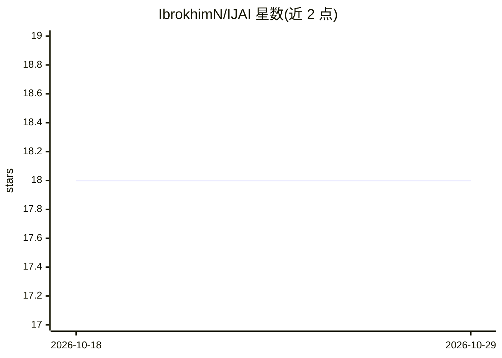

# IbrokhimN/IJAI

⭐ 18 · Python · AGPL-3.0 · 推送 2026-07-15 · [GitHub](https://github.com/IbrokhimN/IJAI) · [官网](https://t.me/IJAIprj) · 个人维护

**整合 LLM/STT/TTS 的跨平台模块化 AI 助手桌面应用**

基于 Electron + React 的跨平台桌面 AI 平台：统一管理并运行 LLM、语音识别（STT）与语音合成（TTS）模型管线，内置 GPT-2/GPT-Neo/Phi-3/LLaMA/DeepSeek R1 等模型目录、各模型的安装脚本与 Python 集成脚本，支持配置驱动架构、自定义数据集与基于 OpenAPI 的插件系统。README 提供最小模型集（CPU 可运行）与全量集两档硬件配置及推理速度基准。项目自我声明为 Work in progress，且当前处于暂停状态，预计 2025 年 12 月 6 日后恢复开发。

## 筛选速览

| 维度 | 判定 | 备注 |
|---|---|---|
| AI 角色 | `ai-native` | 本体是模型或模型工具 |
| 许可风险 | `dual` | AGPL-3.0 |
| 部署形态 | `None` |  |
| 模型依赖 | local-ok | 支持本地模型 |
| 硬件要求 | `gpu-24g` | |
| 安装摩擦 | `medium` | 含编译或系统依赖之一 |
| 成熟度 | `idea` | |

## 能力要点

- LLM/STT/TTS 三类管线集成于单一桌面应用
- 内置多模型目录（GPT-2、Phi-3、LLaMA、DeepSeek R1 等）及各自 installer.sh
- 基于 OpenAPI 的插件系统与配置驱动的助手策略
- 提供最小/全量两档模型集及对应硬件要求与推理基准

## 适用场景

- 在桌面端本地运行文本与语音交互的 AI 助手
- 统一管理多个本地 LLM/STT/TTS 模型与配置
- 通过 OpenAPI 插件扩展助手能力

## 场景标签

`AI 助手` · 领域:对话与助手

## 证据(README 行号)

> L22:  IJAI is a modular AI platform that integrates Large Language Models (LLM) ,
> L32:  Integrated LLM, STT, and TTS pipelines .
> L24:  cross-platform Electron + React desktop application .

## 星数曲线

2026-10-18 18 → 2026-10-29 18（+0）

---
*卡片 v1 · prompt 1.4 · 生成 2026-10-29 · 置信度 high · 依据 README sha `d8c5d1965c13` · [字段定义](../../DATASET.md)*
