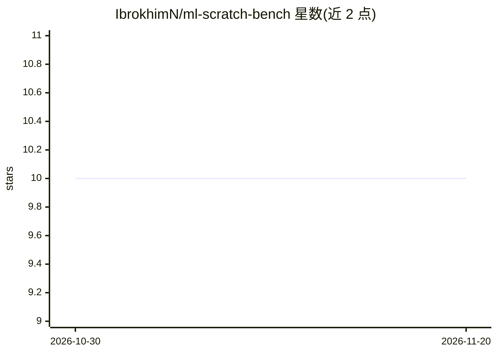

# IbrokhimN/ml-scratch-bench

⭐ 10 · Cuda · MIT · 推送 2026-09-30 · [GitHub](https://github.com/IbrokhimN/ml-scratch-bench) · 个人维护

**机器学习系统基准：10 种算法从零实现的 CPU 与 CUDA 性能对比**

以技术报告形式发布的基准项目：在 C++17 与手写 CUDA 内核中从零实现 AdamW、Nadam、L-BFGS、GMM-EM、Kernel PCA、MLP、随机森林等 10 种算法，不依赖 PyTorch/cuDNN/cuBLAS，在 N=512 至 16,384 的六种合成数据规模上测量 CPU 与 GPU 耗时，给出加速比、盈亏平衡点、三种扩展机制分析及收敛一致性验证，并提供编译命令与输出 CSV 格式以便复现。

## 筛选速览

| 维度 | 判定 | 备注 |
|---|---|---|
| AI 角色 | `ai-native` | 本体是模型或模型工具 |
| 许可风险 | `permissive` | MIT |
| 部署形态 | `None` |  |
| 模型依赖 | — | README 未给出锁定关系 |
| 硬件要求 | — | 无带数字的原话,不猜 |
| 安装摩擦 | `high` | 编译与系统依赖俱全 |
| 成熟度 | — | 结构信号不足 |

## 能力要点

- 10 种算法全部以 C++17 与手写 CUDA 内核实现，零高层库依赖
- 覆盖优化器、神经网络、无监督学习、降维、集成学习五类
- 报告三种扩展机制与 L-BFGS 收敛异常的分析
- 提供固定种子的可复现基准与 CSV 输出格式

## 适用场景

- 复现 10 种 ML 算法的 CPU/GPU 对比基准
- 参考手写 CUDA 内核实现梯度更新与 EM 步骤
- 评估不同样本规模下 GPU 加速的盈亏平衡点

## 场景标签

`模型评测` · 领域:评测与运维

## 证据(README 行号)

> L10: We benchmark ten classical machine learning algorithms implemented entirely from scratch in C++17 (CPU) and CUDA C+
> L31: |Algorithm|Category|GPU Strategy|

## 星数曲线

2026-10-30 10 → 2026-11-20 10（+0）

---
*卡片 v1 · prompt 1.4 · 生成 2026-11-20 · 置信度 high · 依据 README sha `2a90b85954f9` · [字段定义](../../DATASET.md)*
