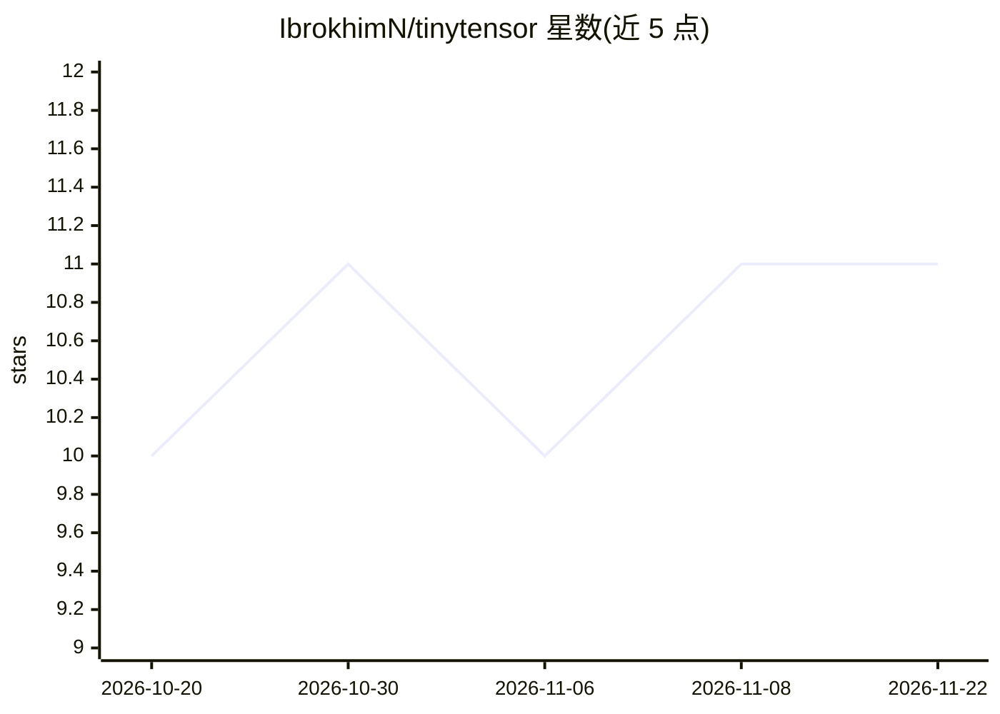

# IbrokhimN/tinytensor

⭐ 11 · Python · MIT · 推送 2026-08-23 · [GitHub](https://github.com/IbrokhimN/tinytensor) · [官网](https://pytinytensor.netlify.app) · 个人维护

**教学用轻量深度学习框架：NumPy 上的 autograd 引擎与神经网络工具集**

基于 NumPy 的微型深度学习框架，实现反向模式自动微分引擎，内置 Linear/Conv2d/Attention/RNN 等层、损失函数与优化器，提供 LeNet/VGG/ResNet 预置模型、MNIST 数据加载与 keras 风格的 compile/fit 训练接口，另含 INT8 量化、剪枝与 ONNX 导出。可选 CuPy 提供 GPU 后端，未安装时回退纯 NumPy CPU 路径。定位为可通读源码的学习项目，README 明确声明速度慢、算子覆盖有限，不适合严肃训练。

## 筛选速览

| 维度 | 判定 | 备注 |
|---|---|---|
| AI 角色 | `ai-native` | 本体是模型或模型工具 |
| 许可风险 | `permissive` | MIT |
| 部署形态 | `library` | 以包/库形式分发 |
| 模型依赖 | — | README 未给出锁定关系 |
| 硬件要求 | — | 无带数字的原话,不猜 |
| 安装摩擦 | `medium` | 含编译或系统依赖之一 |
| 成熟度 | — | 结构信号不足 |

## 能力要点

- 反向模式 autograd 引擎，广播感知梯度与 4D+ matmul 梯度支持
- 内置 Linear/Conv2d/BatchNorm2d/MultiHeadAttention/RNN 等层与 LeNet/VGG/ResNet 模型
- 可选 CuPy CUDA 后端，单次 set_device 全局生效，缺失时回退 NumPy
- INT8 量化、结构化剪枝与 ONNX 导出（经 onnxruntime 验证）

## 适用场景

- 通读源码理解反向传播与 autograd 引擎的实现
- 在小数据集（MNIST/Fashion-MNIST）上动手训练 CNN
- 学习量化、剪枝、ONNX 导出等部署流程的原理

## 场景标签

`模型量化` · 领域:训练与推理

## 证据(README 行号)

> L3: A small, dependency-light autograd engine and neural network toolkit built on
> L5: tensors. It implements reverse-mode automatic differentiation (the same core
> L8: deployment tooling (quantization, pruning, ONNX export).

## 星数曲线

2026-10-20 10 → 2026-11-22 11（+1）

---
*卡片 v1 · prompt 1.4 · 生成 2026-11-19 · 置信度 high · 依据 README sha `e397036f4ce4` · [字段定义](../../DATASET.md)*
