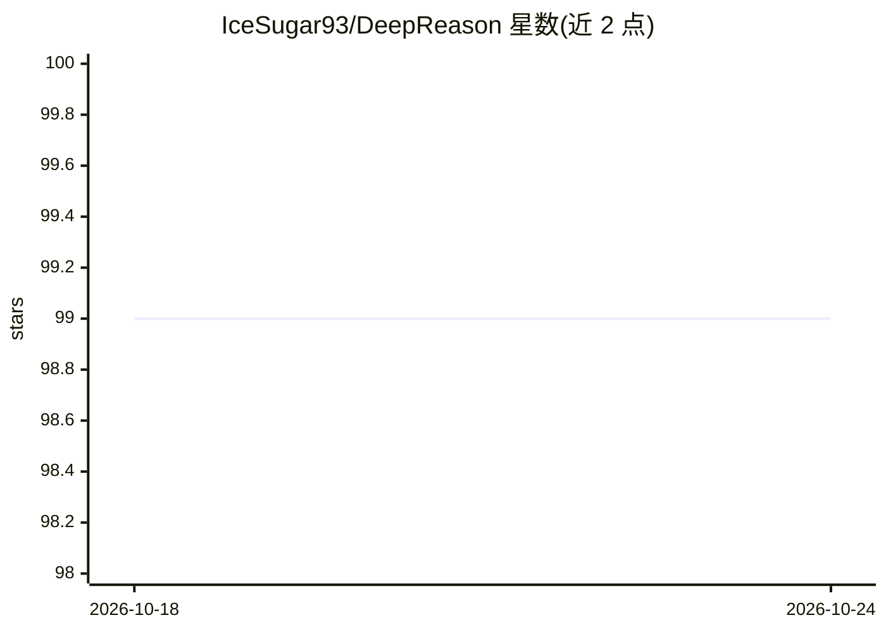

# IceSugar93/DeepReason

⭐ 99 · Python · MIT · 推送 2026-08-30 · [GitHub](https://github.com/IceSugar93/DeepReason) · 个人维护 · 中文 README

**给开发者的 3-Agent 自纠错 Agentic RAG 推理引擎**

基于 LangGraph 状态机编排的 Agentic RAG 推理引擎：Planner 按复杂度判定单跳或多跳检索，Generator/Critic/Reviser 三 Agent 审查-修订闭环迭代收敛答案，Critic 可调用 4 个 MCP 风格工具做断言实证核查，并配备收敛检测、超时、风险标注等 Guardrails。检索采用 Milvus 稠密 + BM25 稀疏 + 重排 + HyDE 扩展，LLM 使用 DeepSeek（OpenAI 兼容 SDK）。提供可复现评测（LLM-as-Judge 加权评分、30 题分层题集）与 FastAPI SSE Web 可视化界面。限制：API 仅支持 deepseek-v4-pro / flash 两款模型。

## 筛选速览

| 维度 | 判定 | 备注 |
|---|---|---|
| AI 角色 | `ai-native` | 本体是模型或模型工具 |
| 许可风险 | `permissive` | MIT |
| 部署形态 | `library` | 以包/库形式分发 |
| 模型依赖 | locked-api |  |
| 硬件要求 | — | 无带数字的原话,不猜 |
| 安装摩擦 | `low` | 无编译、无系统依赖或容器化 |
| 成熟度 | — | 结构信号不足 |

## 能力要点

- Generator/Critic/Reviser 审查-修订闭环，reject 回退初稿避免劣化
- Planner 复杂度判定的多跳检索与子问题拆分
- MCP 风格 4 工具断言核查 + Guardrails（收敛检测/超时/风险标注）
- 可复现评测与 SSE 流式 Web 可视化

## 适用场景

- 在多跳证据问答场景获得经审查修订的回答
- 可视化追踪各 Agent 节点执行与修订轨迹
- 对 RAG 引擎做可复现的对照评测

## 场景标签

`Agent 框架` `多智能体` `RAG` `模型评测` · 领域:Agent 开发

## 证据(README 行号)

> L11: 基于 LangGraph 状态机编排的 **Agentic RAG 推理引擎**：检索链（Planner）驱动多跳证据收集，3-Agent 审查-修订闭环（Generator / Critic / Reviser）迭代收敛答案，配
> L15: - **3-Agent 自纠错闭环** — Critic 逐条审查并裁决（accept / revise / reject），Reviser 按审稿意见修订，Verify 收敛检测提前终止；reject 时回退初稿而非输出劣化答案
> L16: - **多跳检索** — Planner 按问题复杂度判定检索模式，复杂问题拆分为子问题逐跳补充证据链，单跳问题直通生成

## 星数曲线

2026-10-18 99 → 2026-10-24 99（+0）

---
*卡片 v1 · prompt 1.4 · 生成 2026-10-23 · 置信度 high · 依据 README sha `a876916876ec` · [字段定义](../../DATASET.md)*
