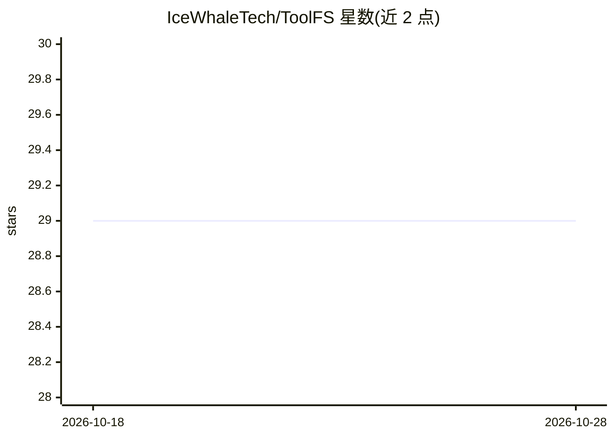

# IceWhaleTech/ToolFS

⭐ 30 · Go · MIT · 推送 2026-10-27 · [GitHub](https://github.com/IceWhaleTech/ToolFS) · 组织维护 · 中文 README

**面向 LLM Agent 的 FUSE 虚拟文件系统框架，统一文件/记忆/RAG/技能接口**

用 Go 编写的虚拟文件系统框架，为 LLM Agent 将文件访问、会话级持久记忆、向量 RAG 查询与 WASM/原生技能执行统一到单一 POSIX 兼容的 /toolfs 命名空间。机制包括基于路径的细粒度权限与会话隔离、整个环境的写时复制原子快照、JSON 审计日志，以及带上下文感知文档的统一技能注册 API。以 Go 库形式提供（go get 安装），README 中含与 AgentFS 的功能对比及在 Apple M4 Pro 上的性能数据。

## 筛选速览

| 维度 | 判定 | 备注 |
|---|---|---|
| AI 角色 | `ai-ecosystem` | LLM/agent 周边工具 |
| 许可风险 | `permissive` | MIT |
| 部署形态 | `None` |  |
| 模型依赖 | — | README 未给出锁定关系 |
| 硬件要求 | — | 无带数字的原话,不猜 |
| 安装摩擦 | `low` | 无编译、无系统依赖或容器化 |
| 成熟度 | — | 结构信号不足 |

## 能力要点

- 单一 /toolfs 命名空间统一文件、会话记忆、RAG 与技能执行
- WASM 与原生技能的统一 Skill API，附上下文感知文档
- 写时复制原子快照支持回滚与可复现环境
- JSON 审计日志与多租户路径级权限隔离

## 适用场景

- 为 Agent 提供文件式工具接口以减少多 API 集成复杂度
- 多租户 Agent 部署中的状态隔离与权限控制
- Agent 环境快照回滚与调试复现

## 场景标签

`Agent 框架` `Agent 记忆` · 领域:Agent 开发

## 证据(README 行号)

> L7: **ToolFS** is a specialized virtual filesystem framework designed for Large Language Model (LLM) agents. It unifies 
> L9: By mapping complex state and capabilities to filesystem operations, ToolFS leverages the LLM's inherent understandin

## 星数曲线

2026-10-18 29 → 2026-10-28 29（+0）

---
*卡片 v1 · prompt 1.4 · 生成 2026-10-26 · 置信度 high · 依据 README sha `d462330eb46c` · [字段定义](../../DATASET.md)*
