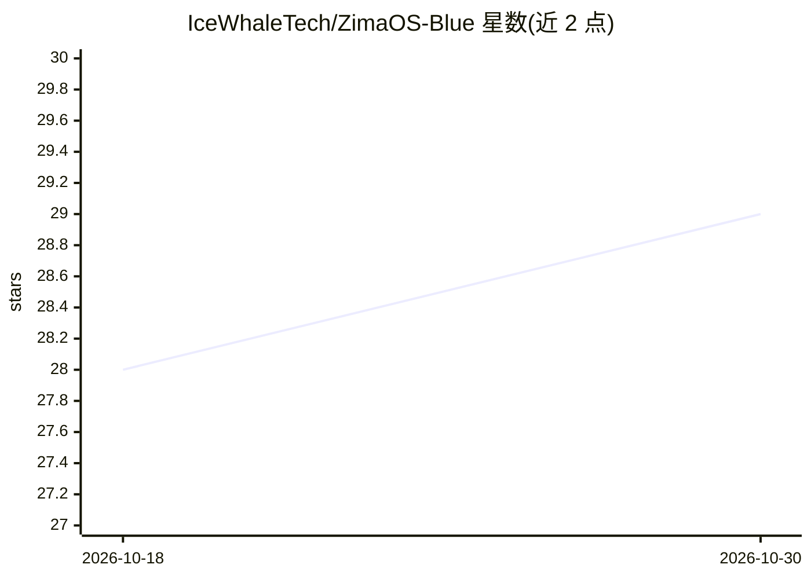

# IceWhaleTech/ZimaOS-Blue

⭐ 29 · Go · MIT · 推送 2026-10-22 · [GitHub](https://github.com/IceWhaleTech/ZimaOS-Blue) · 组织维护

**本地优先的开源 AI Agent 运行时与工具包，面向自托管开发者**

用 Go 编写的自托管 AI Agent 运行时与工具包，静态二进制、内存占用低至 19 MB，可运行于 x86、树莓派、Windows、macOS 等设备。功能覆盖 20+ IM 平台接入、语音 STT/TTS、OCR/PDF/浏览器自动化、深度研究（生成 HTML 报告）、内置 Qwen3.5-0.8B + llama.cpp 本地小模型运行时、技能商店、Harness 评测与演化框架，以及沙箱、提示注入防御等安全治理。提供桌面安装包、安装脚本与源码构建三种方式。限制：调优与变更需通过 Harness 流程验证。

## 筛选速览

| 维度 | 判定 | 备注 |
|---|---|---|
| AI 角色 | `ai-ecosystem` | LLM/agent 周边工具 |
| 许可风险 | `permissive` | MIT |
| 部署形态 | `None` |  |
| 模型依赖 | — | README 未给出锁定关系 |
| 硬件要求 | — | 无带数字的原话,不猜 |
| 安装摩擦 | `medium` | 含编译或系统依赖之一 |
| 成熟度 | — | 结构信号不足 |

## 能力要点

- 100% Go 静态二进制，交叉编译 5 个目标平台，内存占用低至 19 MB
- 内置 Qwen3.5-0.8B + llama.cpp 本地推理运行时
- 四路 Web 访问与三层回退的检索/浏览器运行时，支持三种浏览器引擎
- Harness 评测框架作为运行时原语，覆盖回归、评分与技能演化

## 适用场景

- 在 NAS、树莓派等边缘设备上自托管私人 AI Agent
- 通过 20+ IM 平台与语音界面与 Agent 交互
- 运行本地深度研究并生成带引用的 HTML 报告
- 以 Harness 流程评测并迭代自己的 Agent 技能

## 场景标签

`语音 Agent` `浏览器自动化` `模型评测` `推理引擎` · 领域:效率与自动化

## 证据(README 行号)

> L43: Inspired by OpenClaw, we believe the future of personal computing will be shaped by diverse, local-first AI agents 
> L45: ZimaOS Blue is our answer — a fully open-source, auditable, vendor-neutral, and production-ready agent runtime and 

## 星数曲线

2026-10-18 28 → 2026-10-30 29（+1）

---
*卡片 v1 · prompt 1.4 · 生成 2026-10-26 · 置信度 high · 依据 README sha `ad30b57f8e23` · [字段定义](../../DATASET.md)*
