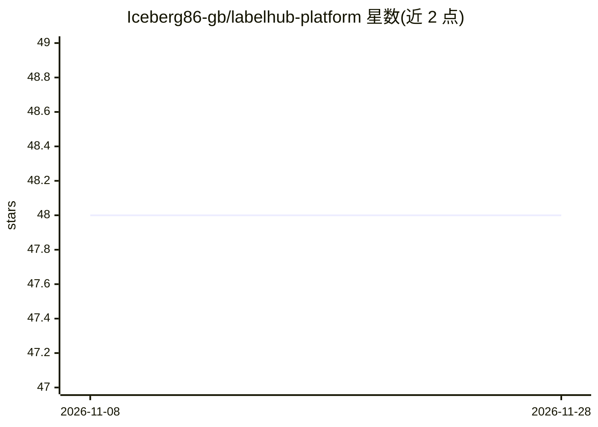

# Iceberg86-gb/labelhub-platform

⭐ 48 · Java · Apache-2.0 · 推送 2026-11-07 · [GitHub](https://github.com/Iceberg86-gb/labelhub-platform) · 个人维护 · 中文 README

**LLM 训练数据标注工作台：AI 预审出证据、人类裁决、全程可审计**

面向 LLM 训练数据生产的 Web 平台，技术栈为 Spring Boot 3 模块化单体 + React 18 + 独立 agent worker。核心机制：Schema 版本、提交、AI 调用、人工裁决与导出快照均以 append-only 账本记录；AI 预审结果连同 prompt 版本、模型、hash、成本一起入账但不改写最终结论；AI 能力改动需先在 HelpSteer2 黄金集（1038 条）离线评测证明有提升才可合并，负结果也留档。内置 MCP Server 允许 Claude Code 等外部 agent 以令牌接入，只能提交走同一校验的提议。导出逐字节可复现。运行需 JDK 17、Node 20+、pnpm、Docker，Python 仅评测需要。

## 筛选速览

| 维度 | 判定 | 备注 |
|---|---|---|
| AI 角色 | `ai-ecosystem` | LLM/agent 周边工具 |
| 许可风险 | `permissive` | Apache-2.0 |
| 部署形态 | `library` | 以包/库形式分发 |
| 模型依赖 | — | README 未给出锁定关系 |
| 硬件要求 | — | 无带数字的原话,不猜 |
| 安装摩擦 | `medium` | 含编译或系统依赖之一 |
| 成熟度 | — | 结构信号不足 |

## 能力要点

- append-only 账本记录 Schema、提交、AI 调用、裁决与导出快照
- AI 预审结果只作为证据，最终裁决由人类审核者做出
- 基于 HelpSteer2（1038 条）的离线评测关卡，改动须证明有提升才合并
- 内置 MCP Server，外部 agent 凭任务令牌接入且只能提交提议

## 适用场景

- 组织标注团队生产可审计的 LLM 训练数据
- 让 AI 预审先行、人工复核把关，降低标注成本
- 验证每一批导出训练数据的 lineage 与可复现性
- 让 Claude Code 等外部 agent 在受约束下参与审核流程

## 场景标签

 · 领域:LLM 数据工程/标注平台

## 证据(README 行号)

> L18: 为此，每一个关键事实都以 **append-only** 的方式记录下来，包括 Schema 版本、提交、AI 调用、人工裁决和导出快照。AI 的结论只作为证据进入账本，最终裁决由人做出。同一份数据导出两次，得到的文件逐字节相同。
> L27: - **外部 agent 也受同样的约束。** 内置 MCP Server，Claude Code 等 agent 用 Owner 按任务签发的令牌接入。外部 agent 只能提交"提议"，提议走同一套校验和评分，永远不会自动通过
> L28: - **可复现的离线评测。** 评测基于 HelpSteer2 黄金集（1038 条），模型调用的录制和回放逐字节复现，CI 每次都会回放验证。用 ChatGPT 账号登录就能跑真实模型评测（ADR-017 / 018）。

## 星数曲线

2026-11-08 48 → 2026-11-28 48（+0）

---
*卡片 v1 · prompt 1.4 · 生成 2026-11-18 · 置信度 high · 依据 README sha `1f62d5ecca2a` · [字段定义](../../DATASET.md)*
