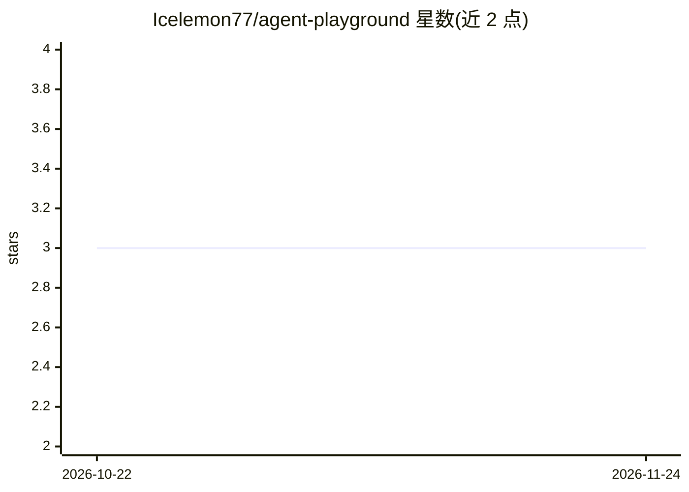

# Icelemon77/agent-playground

⭐ 3 · Python · 推送 2026-10-25 · [GitHub](https://github.com/Icelemon77/agent-playground) · 个人维护 · 中文 README

**开发者可运行可评测的从零手写 AI Agent 系统 playground**

以 Python/asyncio/Pydantic 从零实现的 Agent 系统，不依赖 LangChain 等框架；包含 Function Calling 与文本式 ReAct 两条实现路线、工具注册表、SSE 流式解析、上下文压缩、asyncio 并发执行与失败隔离、TF-IDF 检索的 RAG、SQLite 跨会话记忆，以及自然语言转 SQL 的只读分析 Agent。附带六组真实 API 实测数据、三层 RAG 评测集与 95 个零 API 成本单元测试。提供 CLI 与 FastAPI HTTP 服务两种运行方式，需自行配置兼容 OpenAI 协议的服务商 API key。

## 筛选速览

| 维度 | 判定 | 备注 |
|---|---|---|
| AI 角色 | `ai-native` | 本体是模型或模型工具 |
| 许可风险 | `none` | — |
| 部署形态 | `None` |  |
| 模型依赖 | — | README 未给出锁定关系 |
| 硬件要求 | — | 无带数字的原话,不猜 |
| 安装摩擦 | `low` | 无编译、无系统依赖或容器化 |
| 成熟度 | — | 结构信号不足 |

## 能力要点

- Function Calling 与 ReAct 两种 Agent 范式的可对照实现
- RAG/记忆/SQL 分析各带三层指标评测集与实测数据
- 95 个单元测试不联网、不产生 API 费用
- CLI 与 HTTP 服务（含 SSE 流式接口）两种运行入口

## 适用场景

- 学习 Function Calling 与 ReAct 的从零实现细节
- 为 Agent/RAG/记忆模块跑零成本单元测试
- 本地部署带引用来源的文档问答 API
- 实测上下文压缩与并发执行对 token 和耗时的影响

## 场景标签

`RAG` `文档问答` `模型评测` `教程课程` · 领域:评测与运维

## 证据(README 行号)

> L3: **从零手写的 AI Agent 系统**——不依赖 LangChain 等框架，核心链路全部自己实现。
> L20: 一句话：**把「调一次大模型」这件事，做成一个可测试、可观测、能并发、能算成本的系统。**
> L29: - **检索层** `rag.py`：文档切块、TF-IDF 稀疏向量、余弦相似度检索，把结果拼进 prompt

## 星数曲线

2026-10-22 3 → 2026-11-24 3（+0）

---
*卡片 v1 · prompt 1.4 · 生成 2026-11-22 · 置信度 high · 依据 README sha `2b62449f7d36` · [字段定义](../../DATASET.md)*
