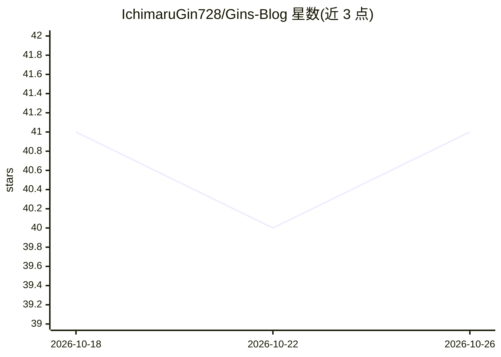

# IchimaruGin728/Gins-Blog

⭐ 41 · Astro · MIT · 推送 2026-05-17 · [GitHub](https://github.com/IchimaruGin728/Gins-Blog) · [官网](https://blog.ichimarugin728.com) · 个人维护 · 中文 README

**部署在 Cloudflare 边缘的博客平台，含 AI 语义搜索与 MCP 接口**

基于 Astro、Hono、Drizzle ORM 与 Cloudflare Workers/D1/R2/KV/Vectorize 构建的边缘优先博客平台，面向自建博客的开发者。提供双语（中英）站点、OAuth 登录（GitHub/Google/Discord）、CMS 编辑器、音乐管理、PWA、自托管分析与全球节点监控。AI 功能包括基于 Workers AI + Vectorize 的 768 维语义搜索，以及通过 MCP 服务器让 Claude Desktop、OpenClaw、Cursor 以对话方式执行建稿、流量分析等操作的 Agentic 接口。安装需 Node.js 25.9+、pnpm 与 Cloudflare 账号，通过交互式脚本或 AI Agent 模式完成资源初始化。

## 筛选速览

| 维度 | 判定 | 备注 |
|---|---|---|
| AI 角色 | `ai-enhanced` | 去掉 AI 部分产品仍成立 |
| 许可风险 | `permissive` | MIT |
| 部署形态 | `library` | 以包/库形式分发 |
| 模型依赖 | — | README 未给出锁定关系 |
| 硬件要求 | — | 无带数字的原话,不猜 |
| 安装摩擦 | `low` | 无编译、无系统依赖或容器化 |
| 成熟度 | — | 结构信号不足 |

## 能力要点

- Cloudflare Workers/D1/R2/KV 全边缘架构，附带部署脚本自动创建资源
- Workers AI + Vectorize 的中英双语语义搜索（768 维 cosine）
- MCP 服务器接口：Claude Desktop / OpenClaw / Cursor 可对话式管理博客内容
- Arctic + Oslo 的 OAuth 登录、会话管理与 Cloudflare Access 管理端防护

## 适用场景

- 在 Cloudflare 边缘部署自托管双语个人博客
- 通过 AI 客户端用自然语言起草文章、分析站点流量
- 需要内置 CMS、OAuth 用户系统与自托管分析的博客站点

## 场景标签

`语义搜索` · 领域:知识与检索

## 证据(README 行号)

> L18: **A high-performance, edge-first blog platform built with modern web technologies**
> L77: - **Semantic Search** - Cloudflare Vectorize + Workers AI for intelligent content discovery
> L112: Built with an Edge-First MCP Server, you can connect **Claude Desktop**, **OpenClaw**, or **Cursor** to your deplo

## 星数曲线

2026-10-18 41 → 2026-10-26 41（+0）

---
*卡片 v1 · prompt 1.4 · 生成 2026-10-25 · 置信度 high · 依据 README sha `98b378135c2a` · [字段定义](../../DATASET.md)*
