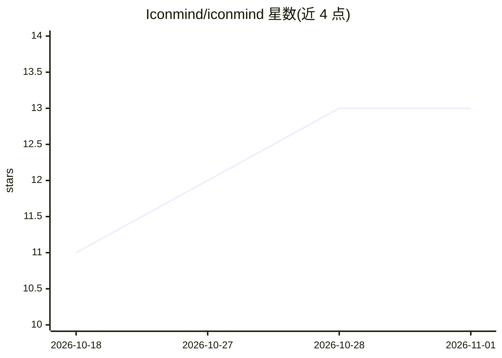

# Iconmind/iconmind

⭐ 13 · TypeScript · MIT · 推送 2026-10-25 · [GitHub](https://github.com/Iconmind/iconmind) · [官网](https://iconmind.dev) · 组织维护

**面向 AI 软件的开源图标集（5,287 图标），含 MCP 服务器**

MIT 许可的开源图标库，覆盖 AI/LLM、agents、MCP、RAG、数据工程等 20 个领域的 5,287 个概念，每个概念 6 种绘制（outline/duotone × 三种 weight）。图标以 TypeScript 声明编译生成，由验证器与夜间扫描强制几何一致性。发布 10 个框架包（React/Vue/Svelte/Solid/Preact/React Native/Astro/Flutter/Laravel/SVG），统一组件 API。另提供 MCP 服务器（npx @iconmind/mcp），让编程助手按真实名称检索图标；该 AI 功能为附加通道，图标集本身不依赖 AI 使用。

## 筛选速览

| 维度 | 判定 | 备注 |
|---|---|---|
| AI 角色 | `ai-enhanced` | 去掉 AI 部分产品仍成立 |
| 许可风险 | `permissive` | MIT |
| 部署形态 | `library` | 以包/库形式分发 |
| 模型依赖 | — | README 未给出锁定关系 |
| 硬件要求 | — | 无带数字的原话,不猜 |
| 安装摩擦 | `low` | 无编译、无系统依赖或容器化 |
| 成熟度 | — | 结构信号不足 |

## 能力要点

- 5,287 图标、20 领域、每概念 6 种绘制，单一来源生成 10 个框架包
- 内置 MCP 服务器，供编程助手检索真实图标名称
- 验证器拒绝非法几何，夜间任务对 31,722 个 cell 做像素级查重
- 树摇经 CI 度量：3 个图标 gzip 约 660 字节

## 适用场景

- 为 agent/MCP/RAG 界面寻找语义明确的领域图标
- 在多框架项目中用统一 API 复用同一图标集
- 让 Claude 等编程助手通过 MCP 直接选用真实图标名

## 场景标签

 · 领域:设计资源/前端组件

## 证据(README 行号)

> L28: **5,287 icons · 31,722 drawings · 10 packages · one generated source of truth.**
> L152: There is an MCP server, so an assistant writing your UI can search the real set instead

## 星数曲线

2026-10-18 11 → 2026-11-01 13（+2）

---
*卡片 v1 · prompt 1.4 · 生成 2026-10-31 · 置信度 high · 依据 README sha `410ee9998218` · [字段定义](../../DATASET.md)*
