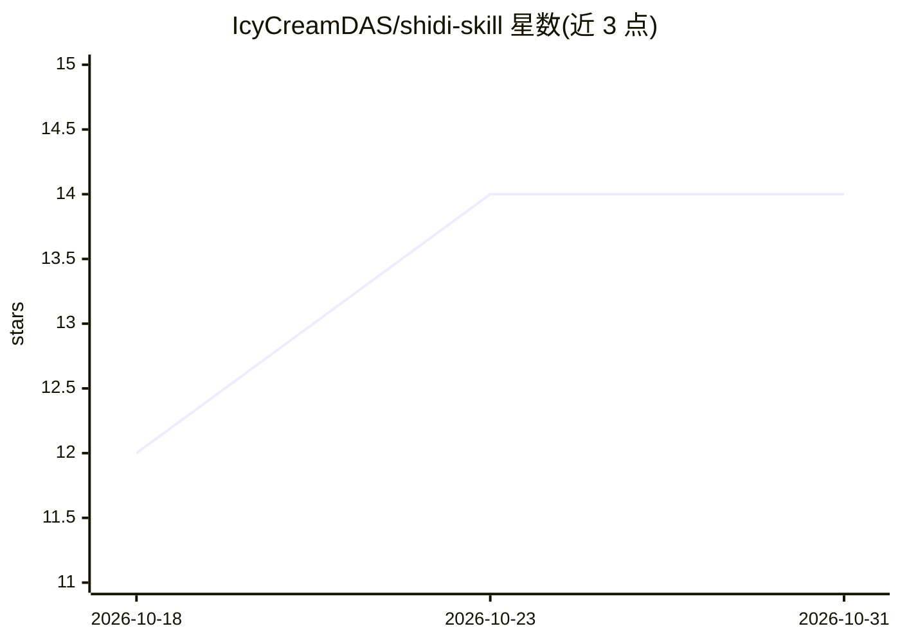

# IcyCreamDAS/shidi-skill

⭐ 14 · Python · MIT · 推送 2026-10-28 · [GitHub](https://github.com/IcyCreamDAS/shidi-skill) · 个人维护 · 中文 README

**跑在 AI IDE 里的科研工作流 skill：想法进、文件出**

面向 AI4S 场景与理工科研究生的 Agent Skill：以纯 SKILL.md + Markdown 形式安装到 Claude Code 等 agent，提供文献调研（多角度检索、七维脚本评分、PDF 批量下载）、实验方案设计、科研作图、论文精读、实验记录五类工作流。每次交付落盘为报告、交叉验证任务书、图与 CSV 文件，验证任务书可交给另一个 LLM 独立核验。核心零依赖，报告渲染与作图为可选依赖；含 Pro/Flash 双模式与合成数据的材料信息学方法学示例。

## 筛选速览

| 维度 | 判定 | 备注 |
|---|---|---|
| AI 角色 | `ai-ecosystem` | LLM/agent 周边工具 |
| 许可风险 | `permissive` | MIT |
| 部署形态 | `library` | 以包/库形式分发 |
| 模型依赖 | — | README 未给出锁定关系 |
| 硬件要求 | — | 无带数字的原话,不猜 |
| 安装摩擦 | `low` | 无编译、无系统依赖或容器化 |
| 成熟度 | — | 结构信号不足 |

## 能力要点

- 文献调研链：9 角度发散检索、七维评分（脚本计算）、DOI 三级去重、PDF 批量下载
- 每次交付必出交叉验证任务书，可交另一 LLM 独立验证并回环迭代
- 纯 SKILL.md + Markdown 核心零依赖，兼容 Claude Code / Codex / OpenClaw 等任意 SKILL.md 规范 agent
- 防护机制：不编造红线、阅读深度标注、报告落盘后跑 verify_refs.py 引用核验

## 适用场景

- 让 AI IDE 里的 agent 替我完成文献调研并交付可归档的报告文件
- 设计实验方案时要求文献支撑与漏洞清单
- 把数据 CSV 交给它生成出版级图表
- 把已交付报告交给另一个 LLM 做独立交叉验证

## 场景标签

`科研工具` · 领域:学习与行业

## 证据(README 行号)

> L17: > shidi 不是填模板的自动化——它是一条跑在 AI IDE 里的完整科研工作流：把脑海中的想法丢给它（文献调研 / 实验方案 / 作图 / 精读 / 数据整理），它在你的机器上跑完脏活累活，交付**真实可用的文件**，产物保
> L165: 只喊"师弟"也行——它会先跟你确认任务类型再开工。兼容任何支持 SKILL.md 规范的 agent（Claude Code / Codex / OpenClaw / OpenCode 等）。
> L185: - **核心零依赖** *Zero core deps*：纯 SKILL.md + Markdown，无需安装任何包

## 星数曲线

2026-10-18 12 → 2026-10-31 14（+2）

---
*卡片 v1 · prompt 1.4 · 生成 2026-10-31 · 置信度 low · 依据 README sha `12446f2d1ad4` · [字段定义](../../DATASET.md)*
