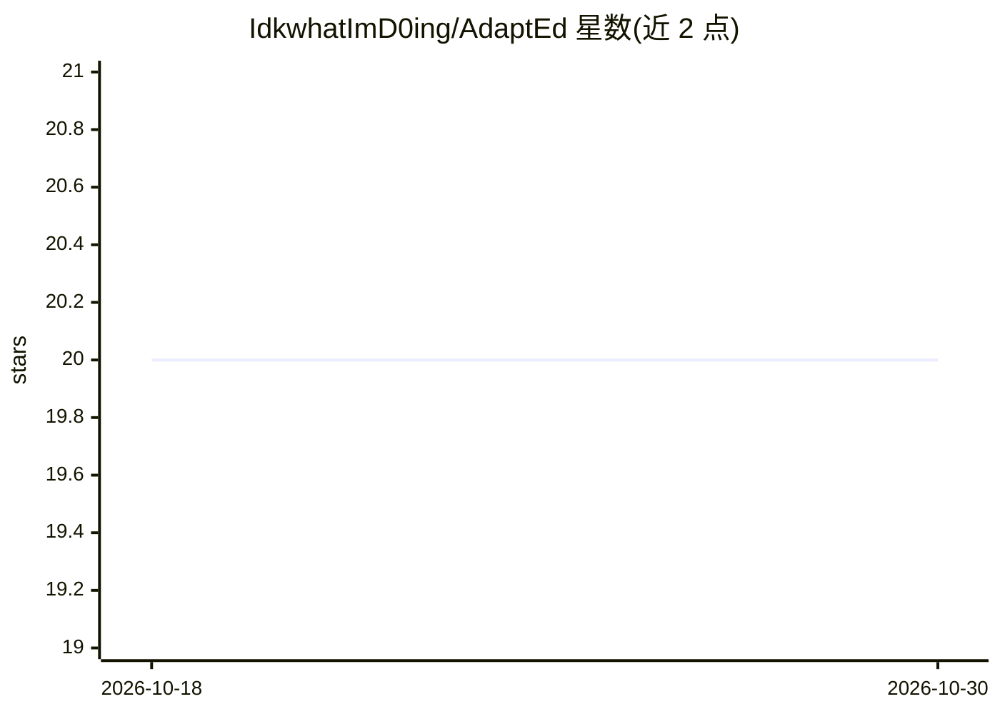

# IdkwhatImD0ing/AdaptEd

⭐ 20 · Jupyter Notebook · MIT · 推送 2026-05-10 · [GitHub](https://github.com/IdkwhatImD0ing/AdaptEd) · [官网](https://www.youtube.com/watch?v=8o1YJUFBcAw) · 组织维护

**AI 语音讲师应用：实时对话授课与情绪感知调速**

LA Hacks 2024 获奖项目（Google Gemini Challenge 第一名、Fetch.ai Agentified 奖）。原始构建为 FastAPI/LangChain/Retell AI/Gemini 后端：语音循环支持打断与重复、由 Gemini 1.5 Pro 从 Wikipedia/YouTube/图片搜索实时聚合幻灯片、摄像头情绪信号反馈调节讲课节奏。当前仓库为浏览器端展示版：后端代码保留于 server/ 但不在运行时调用，语音为预渲染 ElevenLabs MP3，无需 .env 即可 npm run dev 运行。

## 筛选速览

| 维度 | 判定 | 备注 |
|---|---|---|
| AI 角色 | `ai-native` | 本体是模型或模型工具 |
| 许可风险 | `permissive` | MIT |
| 部署形态 | `library` | 以包/库形式分发 |
| 模型依赖 | — | README 未给出锁定关系 |
| 硬件要求 | — | 无带数字的原话,不猜 |
| 安装摩擦 | `low` | 无编译、无系统依赖或容器化 |
| 成熟度 | — | 结构信号不足 |

## 能力要点

- 语音循环：Retell AI 语音捕获 + 三个幻灯片控制工具的对话 Agent
- Gemini 1.5 Pro 多源幻灯片聚合（Wikipedia/YouTube/图片搜索）
- 摄像头情绪信号反馈调节讲课节奏（Hume on Intel Dev Cloud）
- 展示版浏览器即可运行，无需后端与 API key

## 适用场景

- 查看 AI 交互式讲师的原型与架构
- 体验带预渲染旁白的红黑树演示课程
- 参考获奖 hackathon 项目的三反馈循环设计

## 场景标签

`语音 Agent` · 领域:对话与助手

## 证据(README 行号)

> L61: The thesis was a single inversion: **instead of students adapting to the system,
> L71: |**01**|**Voice**|Retell AI captures speech with end-of-turn detection and streams to a LangChain GPT-3.5 agent tha
> L72: |**02**|**Content**|Wikipedia · YouTube transcripts (Gemini multimodal) · Serper image search → Gemini 1.5 Pro slid

## 星数曲线

2026-10-18 20 → 2026-10-30 20（+0）

---
*卡片 v1 · prompt 1.4 · 生成 2026-10-28 · 置信度 high · 依据 README sha `02ba8d8c6f57` · [字段定义](../../DATASET.md)*
