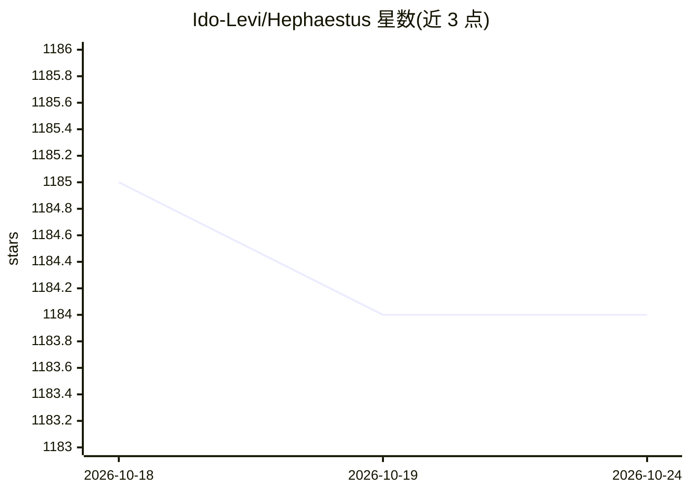

# Ido-Levi/Hephaestus

⭐ 1,184 · Python · NOASSERTION · 推送 2025-12-01 · [GitHub](https://github.com/Ido-Levi/Hephaestus) · 个人维护

**半结构化多智能体框架：工作流由 agent 发现动态生成任务**

面向构建多智能体工作流的 Python 框架：开发者只定义阶段类型（分析/实现/验证）与完成标准，由 agent 在运行中根据发现动态创建任务描述，通过 Kanban 票据与阻塞关系协调，Guardian 监控 agent 与阶段目标的对齐，实时生成依赖图。agent 在 tmux 隔离会话中的 Claude Code/OpenCode/Droid/Codex 等 CLI 工具内运行，使用 Qdrant 向量库（Docker）、OpenAI/OpenRouter/Anthropic 等 API。自带 Hephaestus Dev 预配置的 5 条软件开发工作流（PRD 转软件、修 Bug、索引仓库、功能开发、文档生成）。状态标注 Alpha。

## 筛选速览

| 维度 | 判定 | 备注 |
|---|---|---|
| AI 角色 | `ai-ecosystem` | LLM/agent 周边工具 |
| 许可风险 | `none` | NOASSERTION |
| 部署形态 | `None` |  |
| 模型依赖 | locked-api |  |
| 硬件要求 | — | 无带数字的原话,不猜 |
| 安装摩擦 | `low` | 无编译、无系统依赖或容器化 |
| 成熟度 | `idea` | |

## 能力要点

- agent 可在任意阶段动态创建任务，工作流实时自扩展
- Kanban 票据 + 阻塞依赖 + Guardian 监控协调多 agent
- Hephaestus Dev 提供 5 条预配置软件开发工作流
- agent 运行于 tmux 隔离的 CLI AI 工具（Claude Code 等）会话

## 适用场景

- 从 PRD 出发让多 agent 并行构建软件
- 系统化分析、修复并回归验证 Bug
- 扫描索引既有代码库并生成文档

## 场景标签

`多智能体` `编码 Agent` · 领域:Agent 开发

## 证据(README 行号)

> L44: Here's what I tried instead: **Define logical phase types that are needed to solve problems - like "Plan → Implemen
> L153: - ✅ **Phase definitions** provide work type structure and guidelines
> L180: - **Claude Code**, **OpenCode**, **Droid**, or **Codex** - CLI AI tool that agents run inside

## 星数曲线

2026-10-18 1,185 → 2026-10-24 1,184（-1）

---
*卡片 v1 · prompt 1.4 · 生成 2026-10-21 · 置信度 high · 依据 README sha `9269313098f1` · [字段定义](../../DATASET.md)*
