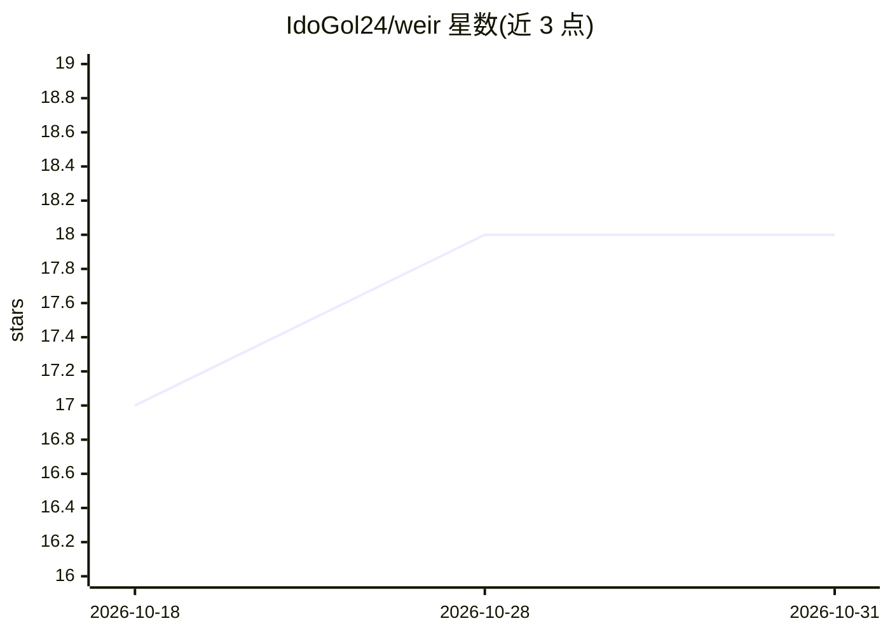

# IdoGol24/weir

⭐ 18 · Python · Apache-2.0 · 推送 2026-10-27 · [GitHub](https://github.com/IdoGol24/weir) · 个人维护

**检测 AI agent 泄露 API 密钥的工具：种假密钥、验真泄露**

面向 agent 开发者的密钥泄露检测工具。两种用法：一是 weir-run 在真实密钥所在位置植入唯一假密钥，对本地假模型运行 agent 自身流程，逐一检查 span、日志、指标、控制台输出、模型提示词与外发请求中是否出现该精确值，给出 leak/clean/incomplete 判定；二是 Claude Code 状态栏统计真实密钥进入上下文或随工具调用外发的情况，可选钩子在模型读取前替换已知密钥。全程离线确定性，不依赖 AI 模型判定。曾借此发现 MLflow 的 CVE-2026-116691。仅匹配整值，不做哈希/截断匹配。

## 筛选速览

| 维度 | 判定 | 备注 |
|---|---|---|
| AI 角色 | `ai-ecosystem` | LLM/agent 周边工具 |
| 许可风险 | `permissive` | Apache-2.0 |
| 部署形态 | `library` | 以包/库形式分发 |
| 模型依赖 | — | README 未给出锁定关系 |
| 硬件要求 | — | 无带数字的原话,不猜 |
| 安装摩擦 | `low` | 无编译、无系统依赖或容器化 |
| 成熟度 | — | 结构信号不足 |

## 能力要点

- 植入假密钥按精确值匹配，检查 span/日志/输出/提示词/外发请求
- Linux 下网络隔离运行 agent，直连外网也可被捕获
- Claude Code 状态栏计数与钩子脱敏（[weir: NAME removed]）
- 附带 weir scan/inventory/audit 命令与 GitHub Action

## 适用场景

- 在 CI 中验证我构建的 agent 是否泄露凭据
- 监控 Claude Code 会话中真实密钥进出情况
- 离线审计已保存的 agent 会话中的凭据暴露

## 场景标签

`网络安全` · 领域:学习与行业

## 证据(README 行号)

> L5: - **The agents you build:** plant fake keys where your real ones live, run the agent's own flows, and get a verdict 
> L25: `weir-run` plants a unique fake key wherever a real one would live, runs your agent's own flows against a local fak
> L51: Setup can also add a redaction hook. When a Read, Bash, Grep, Glob or WebFetch result holds one of your inventoried

## 星数曲线

2026-10-18 17 → 2026-10-31 18（+1）

---
*卡片 v1 · prompt 1.4 · 生成 2026-10-29 · 置信度 high · 依据 README sha `66a7a719c2bf` · [字段定义](../../DATASET.md)*
