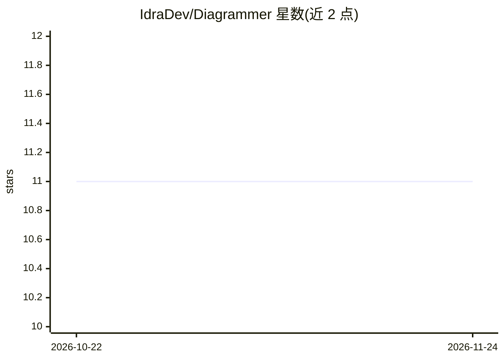

# IdraDev/Diagrammer

⭐ 11 · TypeScript · MIT · 推送 2026-05-08 · [GitHub](https://github.com/IdraDev/Diagrammer) · [官网](https://diagrammer-livid.vercel.app) · 个人维护

**渲染 LLM 生成的图表的本地优先查看器与编写技能**

由两部分组成：一个无后端、schema 驱动的静态网页查看器，读取模型按 SKILL.md 契约生成的 JSON 文档，在可平移缩放的画布上自动布局渲染 mindmap/tree/flowchart/graph/concept/timeline 七类图（含 ER 约定）；以及一份安装到 Cursor/Windsurf/Cline/Codex/Claude Code/Gemini CLI 等编辑器的图表编写技能文件。数据存于 localStorage，支持导出，无账号无云端。Web 端用 Bun/Vite 构建，可托管静态 dist 目录。

## 筛选速览

| 维度 | 判定 | 备注 |
|---|---|---|
| AI 角色 | `ai-enhanced` | 去掉 AI 部分产品仍成立 |
| 许可风险 | `permissive` | MIT |
| 部署形态 | `None` |  |
| 模型依赖 | — | README 未给出锁定关系 |
| 硬件要求 | — | 无带数字的原话,不猜 |
| 安装摩擦 | `low` | 无编译、无系统依赖或容器化 |
| 成熟度 | — | 结构信号不足 |

## 能力要点

- 单一 JSON schema 契约（SKILL.md）驱动七种图型自动布局
- install.sh 一键向 6 种 agent 编辑器安装编写技能，另支持 AGENTS.md 通用形式
- 本地优先：无账号、无后端，数据存 localStorage，可自托管静态 dist
- 支持拖拽编辑、节点连线、明暗主题与内置示例

## 适用场景

- 让 Claude Code/Cursor 等编辑器里的 agent 直接生成可渲染的架构图
- 为数据库设计生成带主外键与基数的 ER 图
- 在本地离线浏览和编辑技术图，不依赖 SaaS 账号

## 场景标签

`编码 Agent` · 领域:编码与开发

## 证据(README 行号)

> L17: A local-first, schema-driven viewer for **LLM-authored diagrams**. Hand a model the authoring skill, it returns a J
> L77: ### Skill (Cursor / Windsurf / Cline / Codex / Claude Code / Gemini)
> L113: `skills/diagrammer/SKILL.md` is the contract LLMs follow to produce diagrams this viewer can render. It documents 

## 星数曲线

2026-10-22 11 → 2026-11-24 11（+0）

---
*卡片 v1 · prompt 1.4 · 生成 2026-11-19 · 置信度 high · 依据 README sha `f6dd33454b29` · [字段定义](../../DATASET.md)*
