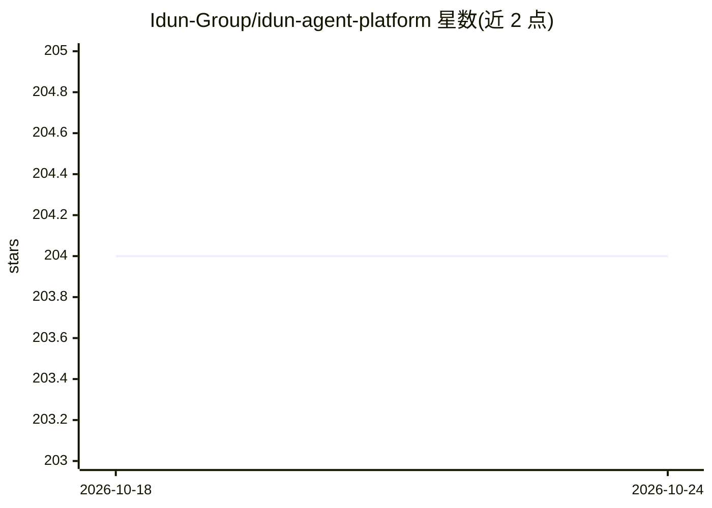

# Idun-Group/idun-agent-platform

⭐ 204 · Python · GPL-3.0 · 推送 2026-09-22 · [GitHub](https://github.com/Idun-Group/idun-agent-platform) · [官网](https://idun-group.com/engine) · 组织维护 · 中文 README

**自托管开源运行时：把 LangGraph/ADK agent 一键部署为生产级 FastAPI 服务**

面向使用 LangGraph 或 Google ADK 构建 agent 的团队，将 agent 包装为单一 FastAPI 进程交付，内置聊天 UI、管理面板、追踪查看器、15+ 护栏（基于 Guardrails AI）、MCP 工具治理、多后端记忆持久化（PostgreSQL/SQLite/内存/Vertex AI）与版本化提示词管理。观测支持 Langfuse、Phoenix、LangSmith、GCP 等多提供方同时接入，并提供 AG-UI/CopilotKit 兼容流式 API。通过 pip 安装单 wheel，YAML 配置，GPLv3 许可，由 Idun Group 维护并提供商业支持。

## 筛选速览

| 维度 | 判定 | 备注 |
|---|---|---|
| AI 角色 | `ai-ecosystem` | LLM/agent 周边工具 |
| 许可风险 | `viral` | GPL-3.0 |
| 部署形态 | `library` | 以包/库形式分发 |
| 模型依赖 | — | README 未给出锁定关系 |
| 硬件要求 | — | 无带数字的原话,不猜 |
| 安装摩擦 | `low` | 无编译、无系统依赖或容器化 |
| 成熟度 | — | 结构信号不足 |

## 能力要点

- 单进程交付：engine SDK + Next.js 聊天 UI + 管理面板 + 追踪查看器
- 15+ 内置护栏（PII/毒性/禁词/话题限制/NSFW 等），按 agent 作用于输入/输出
- MCP 工具治理，支持 stdio/SSE/HTTP/WebSocket 传输
- 多观测提供方（Langfuse/Phoenix/LangSmith/GCP）可同时接入

## 适用场景

- 把已写好的 LangGraph/ADK agent 自托管上线为生产服务
- 对 agent 的工具访问、护栏与可观测性做统一治理
- 在自有基础设施上运行 agent，避免 SaaS 托管

## 场景标签

`Agent 框架` `提示工程` `LLM 可观测性` · 领域:Agent 开发

## 证据(README 行号)

> L20:  Idun Agent Platform is an open-source, self-hosted production wrapper for LangGraph and Google ADK agents. <code>p
> L24: > **Why Idun?** Teams building agents face a tradeoff: build the production wrapper yourself (FastAPI + traces + gu

## 星数曲线

2026-10-18 204 → 2026-10-24 204（+0）

---
*卡片 v1 · prompt 1.4 · 生成 2026-10-22 · 置信度 high · 依据 README sha `f5e137288b59` · [字段定义](../../DATASET.md)*
