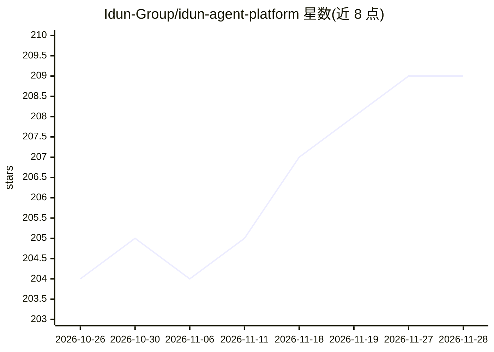

# Idun-Group/idun-agent-platform

⭐ 209 · Python · GPL-3.0 · 推送 2026-11-24 · [GitHub](https://github.com/Idun-Group/idun-agent-platform) · [官网](https://idun-group.github.io/idun-agent-platform/) · 组织维护

**将 LangGraph/ADK agent 打包为生产级 FastAPI 服务的运行时**

开源自托管平台：通过 pip 安装后把 LangGraph 或 Google ADK 编写的 agent 作为 FastAPI 进程运行，内置聊天 UI、管理面板、trace 查看器、15+ 护栏（基于 Guardrails AI）、MCP 工具治理、记忆持久化（PostgreSQL/SQLite/内存等后端）与版本化提示词管理，经单个 YAML 配置并可从管理 REST 热加载。支持 AG-UI/CopilotKit 流式 API、OpenTelemetry 可观测性、OIDC/SSO。Python 3.12/3.13 可用，GPLv3 许可。README 声明项目已停止维护。

## 筛选速览

| 维度 | 判定 | 备注 |
|---|---|---|
| AI 角色 | `ai-ecosystem` | LLM/agent 周边工具 |
| 许可风险 | `viral` | GPL-3.0 |
| 部署形态 | `library` | 以包/库形式分发 |
| 模型依赖 | — | README 未给出锁定关系 |
| 硬件要求 | — | 无带数字的原话,不猜 |
| 安装摩擦 | `low` | 无编译、无系统依赖或容器化 |
| 成熟度 | — | 结构信号不足 |

## 能力要点

- pip install 后 agent 即以 FastAPI 进程运行，wheel 内捆绑引擎、CLI 与三个 UI
- 15+ 护栏按输入/输出策略执行（PII、毒性、话题限制等，基于 Guardrails AI）
- MCP 服务器注册与按 agent 的工具访问控制，支持 stdio/SSE/HTTP/WebSocket
- LangGraph 与 Google ADK 为一等适配，LangChain 经 LangGraph 适配器支持

## 适用场景

- 把本地开发的 LangGraph/ADK agent 部署为带聊天界面的自托管服务
- 通过管理面板统一配置护栏、MCP 工具与提示词版本
- 在自有基础设施上接入 Langfuse/Phoenix 等多可观测性后端

## 场景标签

`Agent 框架` `提示工程` `LLM 可观测性` · 领域:Agent 开发

## 证据(README 行号)

> L23:  Idun Agent Platform is an open-source, self-hosted production wrapper for LangGraph and Google ADK agents. <code>p
> L162: > **Framework support** — LangGraph and Google ADK are first-class today, with full adapters in the engine. LangCh
> L21: > Idun Agent Platform is no longer maintained. The code stays open source under GPLv3, and the documentation stays 

## 星数曲线

2026-10-26 204 → 2026-11-28 209（+5）

---
*卡片 v1 · prompt 1.4 · 生成 2026-11-26 · 置信度 high · 依据 README sha `e34107e14a86` · [字段定义](../../DATASET.md)*
