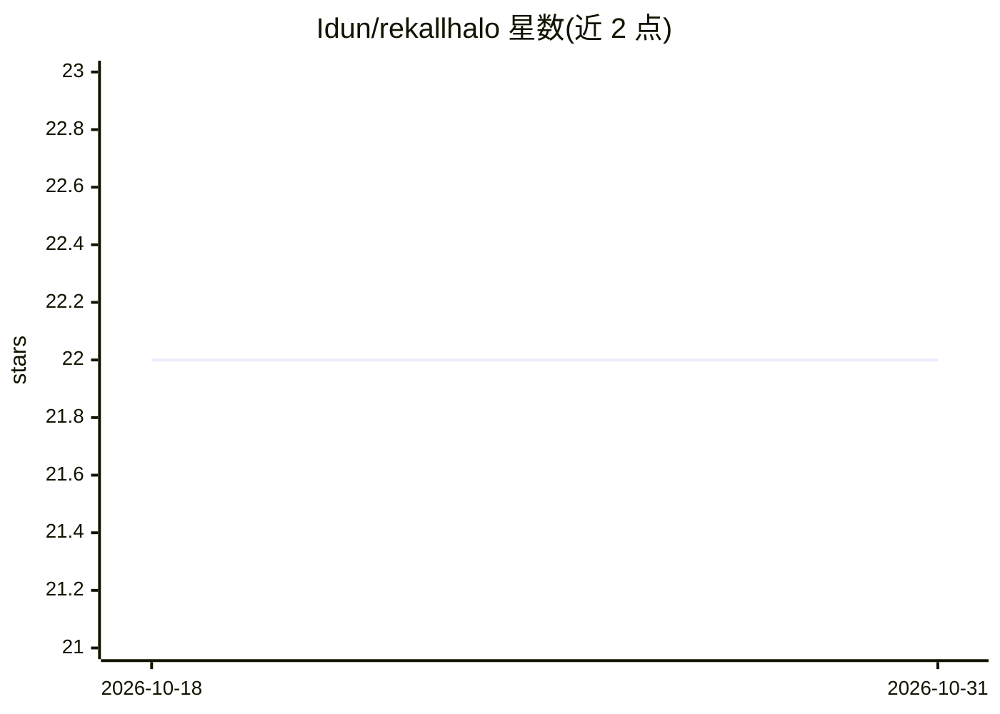

# Idun/rekallhalo

⭐ 22 · TypeScript · 推送 2025-12-18 · [GitHub](https://github.com/Idun/rekallhalo) · 个人维护 · 中文 README

**Gemini 驱动的沉浸式 AI 互动小说引擎**

基于 React 19 + TypeScript 的 Web 应用，由 Google Gemini 驱动互动叙事：支持选项与自然语言双输入、10 种叙事结构与 6 种叙事手法配置、分层记忆（RAG）与上帝模式记忆修正、导演模式预设事件、剧情蓝图脑图编剧工作台。图像生成混合调用 Gemini、Pollinations.ai 与 ModelScope/FLUX；存档以 SVG 节点树展示，数据存于浏览器 LocalStorage。2025-12 起支持 OpenAI 兼容接口。需自备 API Key，经 npm/Vercel 部署运行。

## 筛选速览

| 维度 | 判定 | 备注 |
|---|---|---|
| AI 角色 | `ai-native` | 本体是模型或模型工具 |
| 许可风险 | `none` | — |
| 部署形态 | `library` | 以包/库形式分发 |
| 模型依赖 | — | README 未给出锁定关系 |
| 硬件要求 | — | 无带数字的原话,不猜 |
| 安装摩擦 | `low` | 无编译、无系统依赖或容器化 |
| 成熟度 | — | 结构信号不足 |

## 能力要点

- 选项决策与自然语言双模态输入，AI 作为 DM 实时生成剧情、画面与音效
- 分层长时记忆（RAG）与上帝模式全局查找替换修正记忆
- 剧情蓝图：脑图/列表双视图编剧工作台与智能章纲生成
- 混合生图引擎：Gemini 关键帧 + Pollinations 动态背景 + ModelScope/FLUX

## 适用场景

- 以自然语言或选项推进个人化 AI 互动小说
- 用脑图工作台规划章节大纲与伏笔再交给 AI 推进
- 在平行存档分支间回溯探索不同剧情走向

## 场景标签

`AI 写作` `图像生成` · 领域:内容生成

## 证据(README 行号)

> L4: **主角光环** 是一款基于 **Google Gemini** 大模型驱动的新一代互动小说引擎。它超越了传统的文字冒险游戏，构建了一个集成了**实时多模态生成**、**无限平行宇宙管理**、**动态情感羁绊**与**沉浸式视听特效
> L6: 作为“主角”，你不仅是故事的经历者，更是世界的缔造者。AI 作为“地下城主（DM）”将实时响应你的每一个意图，生成逻辑严密且充满惊喜的剧情、画面与音效。
> L75: * **AI SDK**: Google GenAI SDK (Gemini 2.5/3.0 Models)

## 星数曲线

2026-10-18 22 → 2026-10-31 22（+0）

---
*卡片 v1 · prompt 1.4 · 生成 2026-10-27 · 置信度 high · 依据 README sha `b8749b92e860` · [字段定义](../../DATASET.md)*
