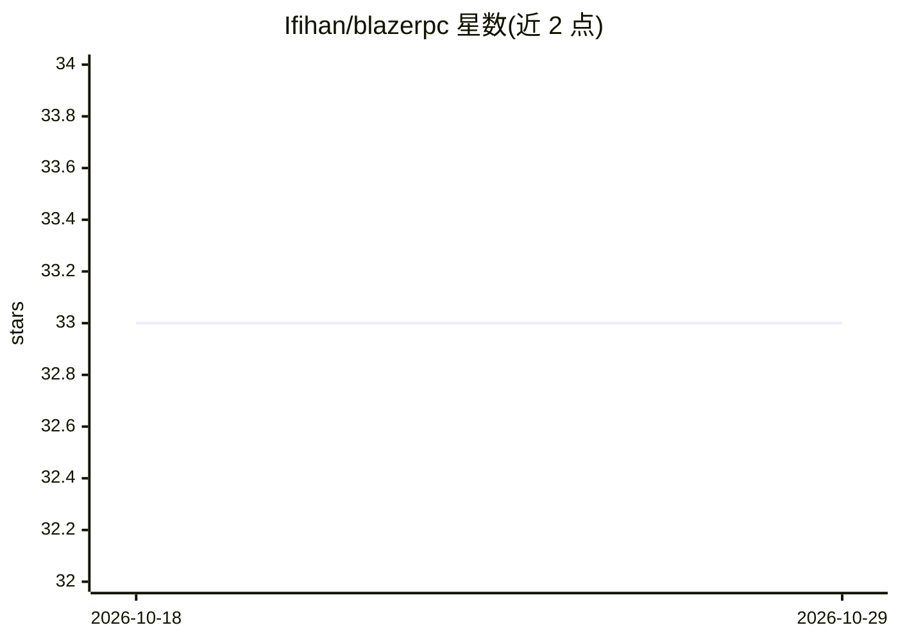

# Ifihan/blazerpc

⭐ 33 · Python · MIT · 推送 2026-06-26 · [GitHub](https://github.com/Ifihan/blazerpc) · [官网](https://ifihan.github.io/blazerpc/) · 个人维护

**Python 库：装饰器方式把 ML 模型发布为 gRPC 推理服务**

面向 Python 开发者的模型服务化库：用 @app.model 装饰器注册普通函数，库自动从类型注解生成 protobuf schema、servicer 与服务器，免手写 .proto 文件。支持自适应批处理（可配批量与超时）、服务端流式输出（适配 LLM 逐 token 生成）、gRPC 健康检查与反射、Prometheus/OpenTelemetry 指标中间件，并提供 PyTorch/TensorFlow/ONNX Runtime 可选张量转换集成。附带 CLI 可启动服务与导出 .proto 文件，任何 gRPC 客户端可直接调用。

## 筛选速览

| 维度 | 判定 | 备注 |
|---|---|---|
| AI 角色 | `ai-ecosystem` | LLM/agent 周边工具 |
| 许可风险 | `permissive` | MIT |
| 部署形态 | `library` | 以包/库形式分发 |
| 模型依赖 | — | README 未给出锁定关系 |
| 硬件要求 | — | 无带数字的原话,不猜 |
| 安装摩擦 | `low` | 无编译、无系统依赖或容器化 |
| 成熟度 | — | 结构信号不足 |

## 能力要点

- 装饰器注册函数即生成 protobuf schema、servicer 与服务器，无需手写 .proto
- 自适应批处理（可配 max_batch_size 与超时）与部分失败隔离
- 服务端流式输出，适配 LLM 逐 token 生成
- 内置 gRPC 健康检查/反射与 Prometheus、OpenTelemetry 中间件

## 适用场景

- 把 scikit-learn/PyTorch 等模型快速发布为生产 gRPC 推理端点
- 为 LLM 推理提供流式 gRPC 服务
- 导出 .proto 文件供多语言客户端调用

## 场景标签

`推理引擎` · 领域:训练与推理

## 证据(README 行号)

> L3: A lightweight, framework-agnostic gRPC library for serving machine learning models in Python. BlazeRPC gives you a F
> L7: Serving ML models over gRPC typically involves writing `.proto` files by hand, compiling them into Python stubs, and

## 星数曲线

2026-10-18 33 → 2026-10-29 33（+0）

---
*卡片 v1 · prompt 1.4 · 生成 2026-10-25 · 置信度 high · 依据 README sha `ec3e3f69c40f` · [字段定义](../../DATASET.md)*
