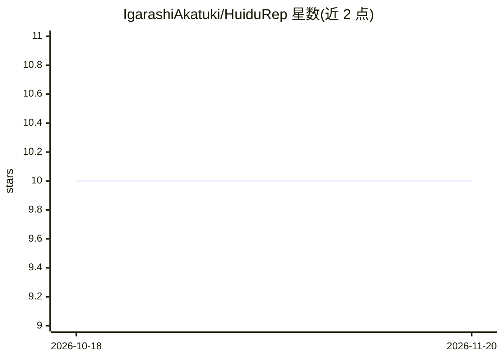

# IgarashiAkatuki/HuiduRep

⭐ 10 · Python · AGPL-3.0 · 推送 2026-09-08 · [GitHub](https://github.com/IgarashiAkatuki/HuiduRep) · 组织维护

**面向科研的胞外记录自监督表示学习框架，用于 spike sorting**

AAAI 2026 论文 HuiduRep 的官方代码仓库，提供胞外记录的自监督表示学习框架：结合对比学习与去噪自编码器，学习对噪声和电极漂移具有鲁棒性的潜在表示；基于该表示构建无标签聚类的 spike sorting 流水线，含训练/验证 notebook、模型定义、权重文件（HuiduRep.pt）、视图增广策略（jitter/noise/crop/collision）及多种聚类监控方法（GMM/Kmeans/HDBSCAN）。面向神经科学与电生理研究者使用。仓库以源码形式提供，README 未给出安装命令。

## 筛选速览

| 维度 | 判定 | 备注 |
|---|---|---|
| AI 角色 | `ai-native` | 本体是模型或模型工具 |
| 许可风险 | `viral` | AGPL-3.0 |
| 部署形态 | `None` |  |
| 模型依赖 | — | README 未给出锁定关系 |
| 硬件要求 | — | 无带数字的原话,不猜 |
| 安装摩擦 | `low` | 无编译、无系统依赖或容器化 |
| 成熟度 | — | 结构信号不足 |

## 能力要点

- 对比学习与去噪自编码器结合的自监督表示学习框架
- 基于表示聚类的 spike sorting 流水线，无需 ground truth 标签
- 提供预训练权重 HuiduRep.pt 与训练/验证 notebook
- 视图增广策略：jitter、noise、crop、collision

## 适用场景

- 对胞外记录进行 spike sorting 分析
- 为神经信号处理学习鲁棒的 spike 表示
- 复现论文中的训练与验证实验

## 场景标签

`科研工具` `模型训练` · 领域:学习与行业

## 证据(README 行号)

> L2: Repository of AAAI 2026 paper: HuiduRep: A Robust Self-Supervised Framework for Learning Neural Representations from
> L11: Extracellular recordings are transient voltage fluctuations in the vicinity of neurons, serving as a fundamental mo

## 星数曲线

2026-10-18 10 → 2026-11-20 10（+0）

---
*卡片 v1 · prompt 1.4 · 生成 2026-11-20 · 置信度 high · 依据 README sha `1280c525458e` · [字段定义](../../DATASET.md)*
