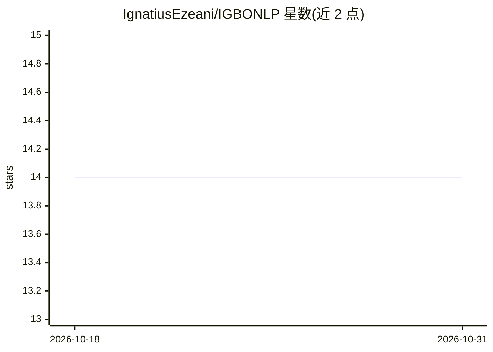

# IgnatiusEzeani/IGBONLP

⭐ 14 · 推送 2026-10-12 · [GitHub](https://github.com/IgnatiusEzeani/IGBONLP) · 组织维护

**伊博语（低资源语言）NLP 研究项目仓库**

名为 IGBONLP 的研究项目仓库，主题标签指向低资源语言（伊博语）的自然语言处理，涉及深度学习与机器翻译。README 仅两行，说明这是该项目的代码仓库，未提供安装、运行方式或项目细节的更多可验证信息，具体内容需查看仓库其他文档与代码目录。

## 筛选速览

| 维度 | 判定 | 备注 |
|---|---|---|
| AI 角色 | `ai-native` | 本体是模型或模型工具 |
| 许可风险 | `none` | — |
| 部署形态 | `None` |  |
| 模型依赖 | — | README 未给出锁定关系 |
| 硬件要求 | — | 无带数字的原话,不猜 |
| 安装摩擦 | `low` | 无编译、无系统依赖或容器化 |
| 成熟度 | — | 结构信号不足 |

## 能力要点

- 主题标签覆盖 igbo-language、machine-translation、nlp 等方向
- 定位为低资源语言 NLP 研究项目代码仓库

## 适用场景

- 查阅伊博语 NLP 与机器翻译相关研究代码
- 关注低资源语言处理资源的开发者参考

## 场景标签

 · 领域:NLP/低资源语言

## 证据(README 行号)

> L1: # IGBONLP
> L2: This is a repository for the IGBONLP Project.

## 星数曲线

2026-10-18 14 → 2026-10-31 14（+0）

---
*卡片 v1 · prompt 1.4 · 生成 2026-10-31 · 置信度 low · 依据 README sha `a09d5a75ca1d` · [字段定义](../../DATASET.md)*
