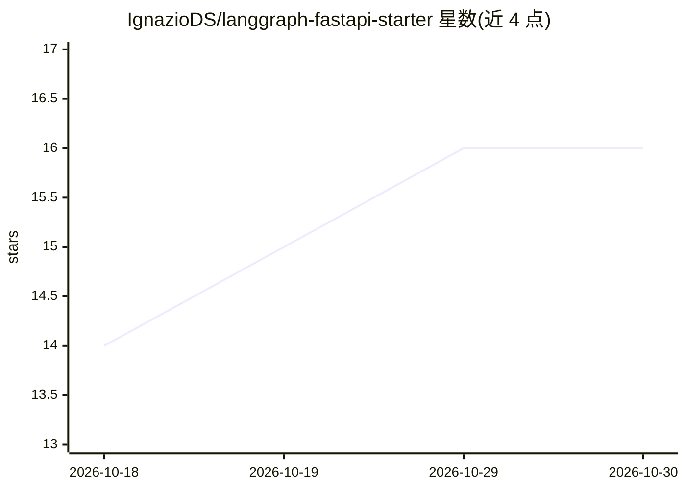

# IgnazioDS/langgraph-fastapi-starter

⭐ 16 · Python · MIT · 推送 2026-09-18 · [GitHub](https://github.com/IgnazioDS/langgraph-fastapi-starter) · 个人维护

**给 AI 工程师的 LangGraph+FastAPI 有状态 agent 后端脚手架**

开源 Python 后端模板，把 LangGraph agent 封装为 FastAPI REST API：提供 Bearer API-key 认证（可撤销、角色、租户隔离）、PostgreSQL 持久化多轮会话、首迁移即启用 pgvector 的 RAG 扩展点、Alembic 迁移、结构化 JSON 日志、Docker/Gunicorn 部署与 pytest/Ruff/MyPy/CI 质量门。agent 行为集中在四个可替换文件；明确不含 UI、计费、后台队列；需配置 OPENAI_API_KEY 与 POSTGRES_PASSWORD，SSE 流式为路线图项。面向想把图原型转成可部署服务的开发者。

## 筛选速览

| 维度 | 判定 | 备注 |
|---|---|---|
| AI 角色 | `ai-ecosystem` | LLM/agent 周边工具 |
| 许可风险 | `permissive` | MIT |
| 部署形态 | `self-host` | docker 或自建部署 |
| 模型依赖 | — | README 未给出锁定关系 |
| 硬件要求 | — | 无带数字的原话,不猜 |
| 安装摩擦 | `low` | 无编译、无系统依赖或容器化 |
| 成熟度 | — | 结构信号不足 |

## 能力要点

- LangGraph 工具调用循环封装为带认证的 FastAPI REST API
- API-key 认证含角色、租户隔离与可撤销密钥哈希存储
- PostgreSQL 单数据源：会话历史、应用数据、pgvector 向量
- Alembic 迁移 + pytest/Ruff/MyPy strict + GitHub Actions CI

## 适用场景

- 把 LangGraph 原型快速变成可部署的 REST API 服务
- 搭建带持久会话与认证的 RAG 助手或内部 copilot 后端
- 作为 AI SaaS 后端起点并按需扩展工具与数据表

## 场景标签

`Agent 框架` · 领域:Agent 开发

## 证据(README 行号)

> L7: A lean, open-source, production-shaped Python backend for **LangGraph agents** with **FastAPI**, **PostgreSQL + pgve
> L17: > Built for AI engineers turning a graph prototype into a durable REST API. Keep the backend plumbing, replace four

## 星数曲线

2026-10-18 14 → 2026-10-30 16（+2）

---
*卡片 v1 · prompt 1.4 · 生成 2026-10-30 · 置信度 high · 依据 README sha `f39c71be4ca9` · [字段定义](../../DATASET.md)*
