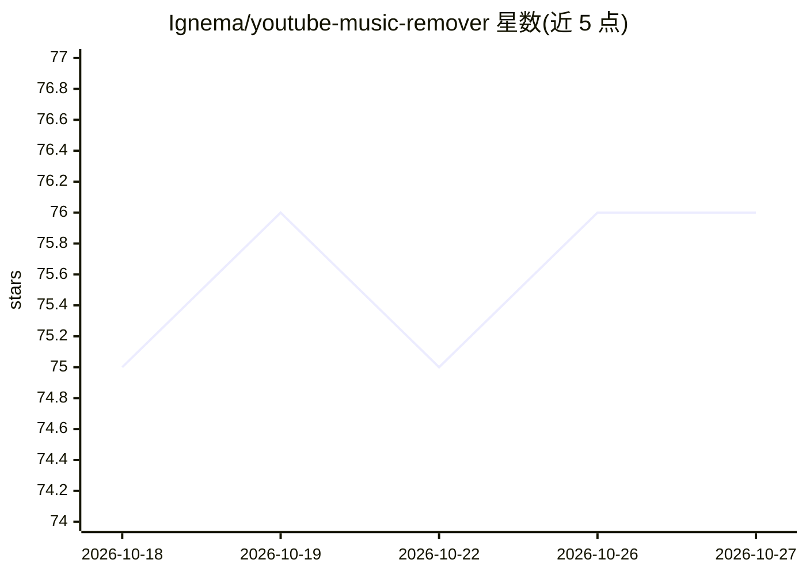

# Ignema/youtube-music-remover

⭐ 76 · Kotlin · MIT · 推送 2026-04-15 · [GitHub](https://github.com/Ignema/youtube-music-remover) · 个人维护

**用 AI 音频分离从视频中去除背景音乐、保留人声**

Murem 提供视频背景音乐去除功能：通过 AI 音频分离模型（Kim Vocal 2 默认、UVR-MDX-NET、Mel-Band/BS-RoFormer 等）分离人声与伴奏，支持 yt-dlp 覆盖的 YouTube、TikTok 等 1000+ 站点及本地文件。形态包括 Jupyter notebook、Gradio Web UI、FastAPI API 服务器和 Android 应用（APK 从 Releases 下载，可经 mDNS 连接 PC 服务器或 Termux 本地运行）。声明仅供教育与个人使用，需自行遵守平台条款与版权法。

## 筛选速览

| 维度 | 判定 | 备注 |
|---|---|---|
| AI 角色 | `ai-native` | 本体是模型或模型工具 |
| 许可风险 | `permissive` | MIT |
| 部署形态 | `self-host` | docker 或自建部署 |
| 模型依赖 | — | README 未给出锁定关系 |
| 硬件要求 | — | 无带数字的原话,不猜 |
| 安装摩擦 | `low` | 无编译、无系统依赖或容器化 |
| 成熟度 | — | 结构信号不足 |

## 能力要点

- 支持 yt-dlp 覆盖的 1000+ 视频站点与本地文件
- 5 个内置分离模型 + 自定义 audio-separator 模型
- 提供 notebook、Gradio Web UI、API 服务器与 Android 应用四种形态
- 批处理队列、任务取消、WebSocket 实时进度等 API 功能

## 适用场景

- 去除视频背景音乐以保留人声对白
- 批量处理多个视频链接的人声分离
- 通过手机应用远程调用 PC 上的分离服务器

## 场景标签

 · 领域:音频处理/视频工具

## 证据(README 行号)

> L8: Remove background music from any video while keeping the vocals and dialogue intact.
> L10: Uses AI-powered audio separation to isolate vocal tracks. Supports YouTube, TikTok, Instagram, Twitter, Vimeo, and 

## 星数曲线

2026-10-18 75 → 2026-10-27 76（+1）

---
*卡片 v1 · prompt 1.4 · 生成 2026-10-24 · 置信度 high · 依据 README sha `3ca1428b7101` · [字段定义](../../DATASET.md)*
