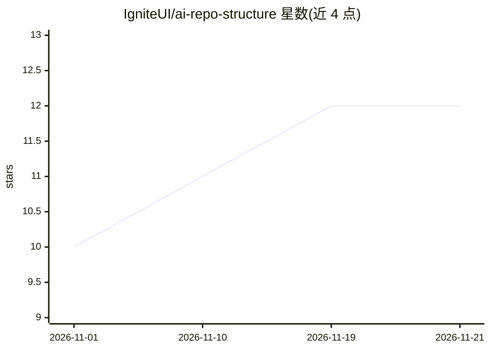

# IgniteUI/ai-repo-structure

⭐ 12 · JavaScript · MIT · 推送 2026-11-17 · [GitHub](https://github.com/IgniteUI/ai-repo-structure) · [官网](https://igniteui.github.io/ai-repo-structure/) · 组织维护

**面向开发者的 AI-ready 仓库结构指南与模板**

同时作为模板、参考实现和学习课程的仓库：展示如何为 AI 编码工具组织指令文件——AGENTS.md、CLAUDE.md、Copilot instructions、自定义 agent、skills 与 hooks 各自的职责与存放位置。提供三工具（Claude Code、GitHub Copilot、OpenAI Codex）的对照决策表、17 模块课程（LEARN.md）及可复制模板；skills 目录作为分发层，需手动复制到对应 skills 目录使用。MIT 许可。

## 筛选速览

| 维度 | 判定 | 备注 |
|---|---|---|
| AI 角色 | `ai-knowledge` | 知识聚合/清单类 |
| 许可风险 | `permissive` | MIT |
| 部署形态 | `None` |  |
| 模型依赖 | — | README 未给出锁定关系 |
| 硬件要求 | — | 无带数字的原话,不猜 |
| 安装摩擦 | `low` | 无编译、无系统依赖或容器化 |
| 成熟度 | — | 结构信号不足 |

## 能力要点

- AGENTS.md/CLAUDE.md/instructions/agents/skills/hooks 的职责对照决策表
- Claude Code、Copilot、Codex 三工具层刻意镜像，便于横向比较
- 17 模块课程 LEARN.md，每模块含可复制模板与本仓库真实示例
- adopt-this-repo 技能可让编码 agent 生成 must-have/optional 分级的采纳计划

## 适用场景

- 为新项目搭建 AI 编码工具的仓库结构
- 整理已有仓库中散乱的 AI 指令文件
- 让编码 agent 基于该技能生成自家仓库的采纳计划

## 场景标签

`教程课程` · 领域:学习与行业

## 证据(README 行号)

> L23: This repository shows a clean alternative. It is a **template**, a **reference implementation**, and a **learning r
> L93: **1. Learn the structure.** Read LEARN.md. Each module explains one file type and gives you a template and a real e

## 星数曲线

2026-11-01 10 → 2026-11-21 12（+2）

---
*卡片 v1 · prompt 1.4 · 生成 2026-11-19 · 置信度 high · 依据 README sha `470accd789f6` · [字段定义](../../DATASET.md)*
