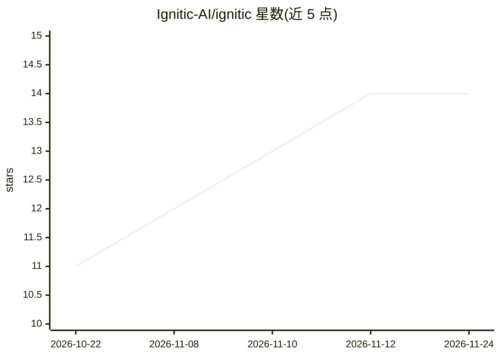

# Ignitic-AI/ignitic

⭐ 15 · TypeScript · NOASSERTION · 推送 2026-11-23 · [GitHub](https://github.com/Ignitic-AI/ignitic) · [官网](https://igniticai.hinterbuild.com/) · 组织维护

**自托管的电商运营 AI 代理平台：一个聊天入口驱动 14 个专家代理**

开源的自托管电商平台，用 14 个专家代理（产品调研、商业分析、营销、SEO、Shopify、HubSpot、客服、邮件营销、广告等）覆盖销售、营销、支持、广告与分析操作，共 190+ 个 MCP 工具分布在 15 个领域。架构上由 LangGraph supervisor 编排子代理，WebSocket 流式输出，记忆采用 MongoDB 检查点与向量存储加 Neo4j 知识图谱；凭据以 AES-256-GCM 加密存储。整体通过 docker compose 一键部署，要求 OpenRouter API key。README 自述为早期版本，测试覆盖不完全且 1.0 前可能有破坏性变更。

## 筛选速览

| 维度 | 判定 | 备注 |
|---|---|---|
| AI 角色 | `ai-native` | 本体是模型或模型工具 |
| 许可风险 | `none` | NOASSERTION |
| 部署形态 | `self-host` | docker 或自建部署 |
| 模型依赖 | locked-api |  |
| 硬件要求 | — | 无带数字的原话,不猜 |
| 安装摩擦 | `low` | 无编译、无系统依赖或容器化 |
| 成熟度 | `idea` | |

## 能力要点

- 14 个专家代理 + 155+ 工具的 Custom Agent，全部经 MCP 服务器挂载
- LangGraph supervisor 多代理编排，WebSocket 流式响应
- 检查点/向量记忆（MongoDB）与知识图谱记忆（Graphiti + Neo4j）
- n8n 工作流模板自动注册为代理工具

## 适用场景

- 在一个聊天入口统一操作 Shopify 商品、客服工单与广告投放
- 自托管平台整合 HubSpot、Zendesk、Mailchimp 等多个业务系统
- 用 n8n 工作流扩展代理可调用的工具

## 场景标签

`多智能体` `聊天机器人` · 领域:Agent 开发

## 证据(README 行号)

> L5: **Open-source, real-time AI agents that run your e-commerce operations.**
> L24: Ignitic is that glue, already built. A **super-agent** on your team's chat delegates to specialist agents — a busin

## 星数曲线

2026-10-22 11 → 2026-11-24 14（+3）

---
*卡片 v1 · prompt 1.4 · 生成 2026-11-18 · 置信度 high · 依据 README sha `cb6363bfc18f` · [字段定义](../../DATASET.md)*
