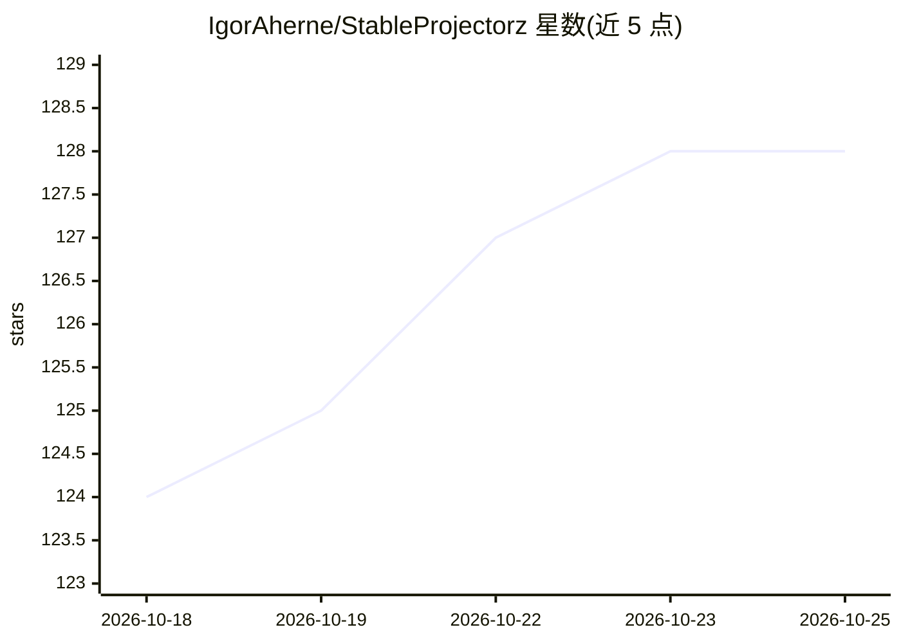

# IgorAherne/StableProjectorz

⭐ 128 · C# · AGPL-3.0 · 推送 2026-08-23 · [GitHub](https://github.com/IgorAherne/StableProjectorz) · [官网](https://stableprojectorz.com) · 个人维护

**基于 Unity 的工具：用 Stable Diffusion 为 3D 模型生成贴图与模型**

用 Unity 6000 构建的桌面工具，面向游戏开发者与美术人员。通过多相机系统渲染深度、法线、顶点色等控制图，发送至 A1111/Forge 的 Stable Diffusion WebUI 生成纹理，再经投影烘焙回 3D 模型的 UDIM 纹理数组。另支持向 Trellis/Hunyuan 等 WebUI 提交请求从 2D 图生成 3D 模型（GLB）。含外部 Agent Bridge（TCP/JSON，MCP 可接）。需在 Unity 中自行构建运行，无现成安装包。

## 筛选速览

| 维度 | 判定 | 备注 |
|---|---|---|
| AI 角色 | `ai-native` | 本体是模型或模型工具 |
| 许可风险 | `viral` | AGPL-3.0 |
| 部署形态 | `None` |  |
| 模型依赖 | — | README 未给出锁定关系 |
| 硬件要求 | — | 无带数字的原话,不猜 |
| 安装摩擦 | `low` | 无编译、无系统依赖或容器化 |
| 成熟度 | — | 结构信号不足 |

## 能力要点

- 多相机渲染深度/法线/顶点色控制图发送至 StableDiffusion（A1111/Forge）
- 生成结果投影烘焙回 UDIM 纹理数组并防接缝膨胀
- 对接 Trellis/Hunyuan WebUI 从 2D 图生成 3D 模型（GLB）
- Agent Bridge：TCP/JSON 控制接口，供 MCP 等外部工具调用

## 适用场景

- 为游戏 3D 模型生成并烘焙纹理
- 从 2D 图片生成 3D 模型并导入编辑
- 通过外部 Agent/MCP 程序控制应用状态与 UI 操作

## 场景标签

`图像生成` · 领域:内容生成

## 证据(README 行号)

> L1: StableProjectorz: A free tool for making 3D and textures via StableDiffusion
> L5: **StableProjectorz** is a tool for texturing 3D models using StableDiffusion.
> L48: * **Depth Camera:** Renders black and white image to send to StableDiffusion (not an exact viewport depth).
> L61: * **Pipeline:** `StableDiffusion_Hub` → `SD_Generate_PayloadMaker` → `SD_Generate_NetworkSender` (Talks to A1111/Fo

## 星数曲线

2026-10-18 124 → 2026-10-25 128（+4）

---
*卡片 v1 · prompt 1.4 · 生成 2026-10-23 · 置信度 high · 依据 README sha `289d197ce552` · [字段定义](../../DATASET.md)*
