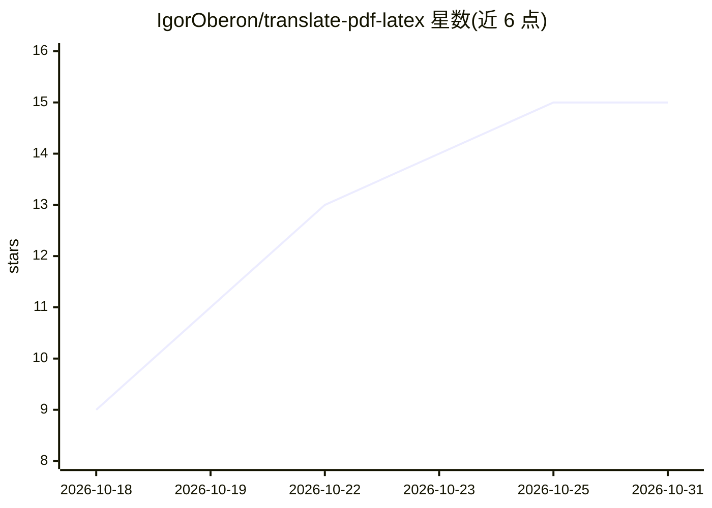

# IgorOberon/translate-pdf-latex

⭐ 15 · Python · MIT · 推送 2026-10-25 · [GitHub](https://github.com/IgorOberon/translate-pdf-latex) · [官网](https://github.com/IgorOberon/translate-pdf-latex/releases) · 个人维护

**本地模型驱动的整书翻译与 LaTeX/PDF 排版流水线**

面向个人用户的本地优先图书翻译管线：用 MinerU 从 PDF 提取文本、公式与插图，生成 Markdown，经本地 Hy-MT2（通过 LM Studio 的 OpenAI 兼容 API）翻译，再经 Pandoc/XeLaTeX 排版生成 PDF。核心机制包括可恢复的任务缓存、公式/代码/脚注遮蔽与校验、可复用的术语表（glossary.md 作为指令传入而非硬替换）。打包好的端到端路线当前聚焦 EN→RU 与准备好的 DE→RU OCR；其他语言对仅 MT 阶段可配置。主要验证环境为 Windows，附带可移植 agent skill 与 26 个可选专家 skill；云端与昂贵模型均非必需。

## 筛选速览

| 维度 | 判定 | 备注 |
|---|---|---|
| AI 角色 | `ai-native` | 本体是模型或模型工具 |
| 许可风险 | `permissive` | MIT |
| 部署形态 | `desktop` | 安装包/桌面程序 |
| 模型依赖 | — | README 未给出锁定关系 |
| 硬件要求 | — | 无带数字的原话,不猜 |
| 安装摩擦 | `medium` | 含编译或系统依赖之一 |
| 成熟度 | — | 结构信号不足 |

## 能力要点

- MinerU 提取 PDF（含公式/插图）→本地 Hy-MT2 翻译→LaTeX/PDF 排版的端到端管线
- 任务文件夹隔离、可恢复运行、可校验缓存
- 公式/代码/链接/脚注遮蔽及损坏遮蔽检查
- glossary.md 术语表作为翻译指令传入，支持单独准备的术语流程

## 适用场景

- 把英文技术书完整翻译成俄文并排版为 PDF
- 用现有 LaTeX 骨架或已准备的 OCR 项目做本地翻译
- 通过 OpenCode 等终端 agent 以 skill 方式驱动翻译流程

## 场景标签

`文档解析` · 领域:知识与检索

## 证据(README 行号)

> L5: Local-first book translation with resumable jobs, protected formulas, and a portable AI-agent skill. The translation
> L11: Главная идея: **книгу переводит локальная модель, а недорогой ИИ-агент только управляет конвейером**. Можно работат
> L13: По умолчанию: **Hy-MT2 локально, без облака, обязательной полировки и автоматического создания глоссария**. Существ

## 星数曲线

2026-10-18 9 → 2026-10-31 15（+6）

---
*卡片 v1 · prompt 1.4 · 生成 2026-10-30 · 置信度 high · 依据 README sha `1ff03359ffab` · [字段定义](../../DATASET.md)*
