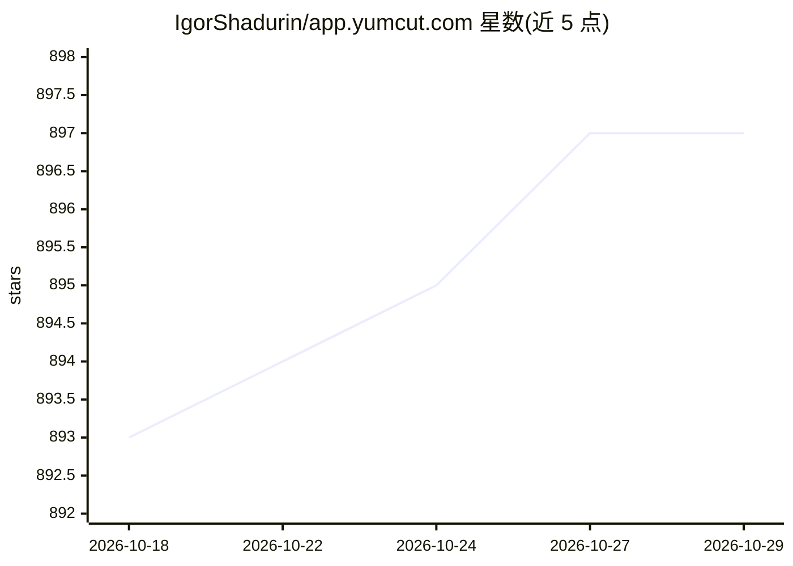

# IgorShadurin/app.yumcut.com

⭐ 897 · TypeScript · NOASSERTION · 推送 2026-10-24 · [GitHub](https://github.com/IgorShadurin/app.yumcut.com) · [官网](https://yumcut.com) · 个人维护

**自托管的 AI 竖版短视频生成器：提示词转 TikTok/Shorts 成片**

开源、可自托管的端到端短竖版视频生成工具：用户提供想法，系统生成脚本、配音、画面、字幕与最终剪辑，输出 9:16 可发布视频，面向创作者、代理机构与增长团队。支持模板、批量制作、多语言版本与自带 provider 的成本控制。提供带 bearer-key 的 User API 供外部工具与 AI agent 自动化项目流程。个人使用免费，托管给客户或商业运营需购买商业许可。技术安装细节移至 docs/tech.md。

## 筛选速览

| 维度 | 判定 | 备注 |
|---|---|---|
| AI 角色 | `ai-native` | 本体是模型或模型工具 |
| 许可风险 | `none` | NOASSERTION |
| 部署形态 | `None` |  |
| 模型依赖 | — | README 未给出锁定关系 |
| 硬件要求 | — | 无带数字的原话,不猜 |
| 安装摩擦 | `low` | 无编译、无系统依赖或容器化 |
| 成熟度 | — | 结构信号不足 |

## 能力要点

- 提示词→脚本/配音/画面/字幕→9:16 成片的端到端生成
- bearer-key User API 支持 AI agent 自动化管理项目全流程
- 自带 provider、本地组件运行与质量/速度权衡调节
- 多语言版本与多品牌/客户批量生产工作流

## 适用场景

- 为 faceless 频道做 TikTok/Shorts/Reels 日常发布
- 把一个想法快速做成多语言版本扩大触达
- 代理机构跨品牌批量生产短视频
- 通过 API 用 AI agent 自动化视频生产流程

## 场景标签

`视频生成` · 领域:内容生成

## 证据(README 行号)

> L8: You provide the idea, YumCut generates the script, voice, visuals, captions, and final edit for a ready-to-post 9:16
> L25: YumCut includes a bearer-key User API for automating project workflows from external tools, backend jobs, and AI ag

## 星数曲线

2026-10-18 893 → 2026-10-29 897（+4）

---
*卡片 v1 · prompt 1.4 · 生成 2026-10-21 · 置信度 high · 依据 README sha `1730c80a7839` · [字段定义](../../DATASET.md)*
