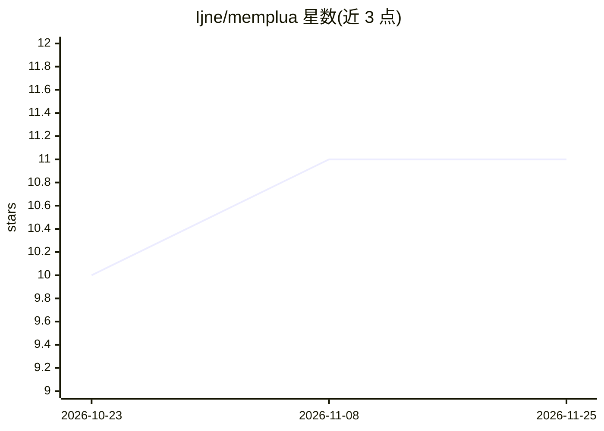

# Ijne/memplua

⭐ 11 · Go · Apache-2.0 · 推送 2026-09-29 · [GitHub](https://github.com/Ijne/memplua) · [官网](https://memplua.space) · 个人维护 · 中文 README

**本地后台运行的桌面应用：把音频内容转为结构化知识笔记**

本地优先的个人知识应用：用户选择麦克风或电脑音频作为来源，后台识别语音、聚合相关概念，生成含术语解释、结论、概念关联、标签与原文引用的结构化笔记，经人工审核批准后纳入知识库，并可导出到 Obsidian。语音识别与语言处理均在本地运行，不依赖云端。当前为 Alpha v2 早期阶段，由个人开发者维护，仅提供 Windows 安装文档。

## 筛选速览

| 维度 | 判定 | 备注 |
|---|---|---|
| AI 角色 | `ai-native` | 本体是模型或模型工具 |
| 许可风险 | `permissive` | Apache-2.0 |
| 部署形态 | `None` |  |
| 模型依赖 | — | README 未给出锁定关系 |
| 硬件要求 | — | 无带数字的原话,不猜 |
| 安装摩擦 | `low` | 无编译、无系统依赖或容器化 |
| 成熟度 | `idea` | |

## 能力要点

- 后台监听麦克风/系统音频并转为结构化笔记
- 笔记包含术语解释、概念关联、标签与原文引用
- 人工审核批准机制，未经确认不写入知识库
- 语音识别与语言处理全部本地运行

## 适用场景

- 上课或开会时后台收集要点，事后整理进知识库
- 看视频/听播客时自动生成带引用的结构化笔记
- 把整理好的笔记导出到 Obsidian 持续积累

## 场景标签

`知识库管理` `语音识别` · 领域:知识与检索

## 证据(README 行号)

> L5: memplua is a personal knowledge companion that quietly works in the background. It listens to the sources you choose
> L18: 2. **memplua works in the background.** It recognizes speech, brings related ideas together, and turns them into a 
> L35: Speech recognition and language processing run locally on your computer. Your material remains under your control, 

## 星数曲线

2026-10-23 10 → 2026-11-25 11（+1）

---
*卡片 v1 · prompt 1.4 · 生成 2026-11-19 · 置信度 high · 依据 README sha `63af9fab8f57` · [字段定义](../../DATASET.md)*
